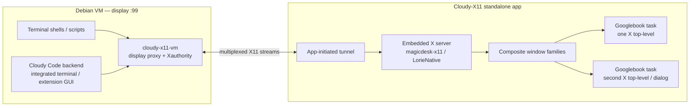

# Cloudy-X11 — product goal and current state

**Status:** active. **Last updated:** 2026-10-17. This is the persistent product
goal. Read it with `TODO.md`, [`NEXT-STEPS.md`](NEXT-STEPS.md) and
`android/cloudy-x11/AGENTS.md` after any context compaction. The long-form design is in
[`docs/plan/x11-forwarding-evaluation.md`](../plan/x11-forwarding-evaluation.md);
the engine decision is [`ADR-001`](../decisions/ADR-001-embedded-x11.md).

## Objective

Build **Cloudy-X11 as a separate Googlebook application**: a MobaXterm-style X11
forwarder for the built-in Debian Linux VM. X11 applications launched **anywhere
in the VM** must appear directly on the Googlebook OS desktop as **one free-form,
resizable window per X11 application** — not inside the Terminal app's built-in
graphics screen or an HTML canvas.

Required sources of X11 clients:

1. **Terminal app shells** and scripts.
2. **Cloudy Code** (the VS Code/Code - OSS workbench using the same Linux VM
   backend): integrated terminals, extension-host processes and tasks.
3. Any other VM process that inherits the VM's X11 environment.

The Terminal app's built-in X11 server is **bypassed**, not extended. Cloudy-X11
owns the VM's default display endpoint and the per-window Android hosts.

## Non-goals

- Replacing the Code - OSS/Cloudy Code workbench UI with a Linux GUI.
- Streaming a Linux desktop or the Terminal app's graphics screen into Cloudy-X11.
- A per-shell alias or per-app xpra wrapper as the final forwarding model.
- A raw X11 TCP listener, an undocumented VM-control API, or claiming
  window-independent VM lifetime (still roadmap on Googlebook).
- GBCode depending on Cloudy-X11 code, or Cloudy-X11 depending on GBCode,
  Workbench or Code-OSS code.

## Architecture

- **VM-wide display:** `cloudy-x11-vm` owns `:99` and a per-user Xauthority. The
  environment is installed in the login profile, systemd user environment and
  the Cloudy Code backend launch, so both the Terminal shell and Cloudy Code's
  integrated terminal use `DISPLAY=:99`. The Terminal's built-in graphics screen
  remains Google's UI and is not the endpoint.
- **Forwarding:** the app connects to the VM's forwarded control port (the
  Terminal's documented host-browser forwarding direction); the VM proxy accepts
  X11 client connections and multiplexes their byte streams back over the
  app-initiated connection. No guest→host listener and no X11 TCP.
- **Host X server:** the embedded `magicdesk-x11` engine consumes each stream
  with `lorieServerAcceptClient(fd)` and discovers Composite window families.
- **Per-window host:** each X top-level becomes one free-form Googlebook task
  with the system caption, title/icon, taskbar/Alt+Tab entry, multi-instance,
  native two-way resize (`lorieOutputResize`), input/IME, clipboard and
  `WM_DELETE_WINDOW` close semantics.
- **Reusable core:** `cloudy-x11-core` (engine service, window-host manager,
  tunnel, VM pairing, input/resize/clipboard/close contract) is reused by the
  later remote-console app. `cloudy-x11-app` is the standalone APK;
  `cloudy-x11-vm` is the guest package.

## Product boundary

Cloudy-X11 is its own APK and Gradle project. GBCode/Cloudy Code are VM-side
consumers of the same display; neither is a dependency. The current X11
activities inside `dev.gbcode.app` are the prototype from which the standalone
app is extracted. Do not add new X11 features back into GBCode.

## Current state (2026-10-17)

- **Standalone app:** extracted to `android/cloudy-x11` (package
  `dev.cloudy.x11`), separate Gradle project and APK. It builds (3.5 MB debug),
  installs as `dev.cloudy.x11`, and launches as its own free-form Googlebook
  task. The GBCode app's X11 activities/launcher/token/assets/resources were
  removed; both APKs build. The release-signed GBCode update was installed on
  the device; `dev.gbcode.app` and `dev.cloudy.x11` coexist, and GBCode no
  longer exposes an X11 launcher. The standalone app still carries the
  existing xpra/HTML5 prototype as a temporary carrier; this is not the target
  transport. The VM still has the previous GBCode token, so the standalone
  launcher shows setup required until the new app's setup command is run.
- **Prototype pairing verified:** the standalone token was written to the VM's
  `x11-token` and the sessiond/proxy/X11 services restarted. The launcher now
  reads "Ready — pick an application"; X Eyes started session `14510` and
  rendered in the standalone app (`/tmp/cloudy-x11-xeyes2.png`). Readiness uses
  the authenticated `/list` (the HMAC ping remains diagnostic). This is the
  xpra prototype, not the target per-window path.
- **Current prototype:** `dev.gbcode.app` has `X11Activity`/`X11AppsActivity`,
  a per-install token from `GbCodeApp`, and the VM setup asset. The VM payload
  uses xpra sessions plus an HTTP/token proxy and per-shell `.bashrc` aliases.
  It does not provide VM-wide display or per-X-window tasks.
- **Engine:** `magicdesk-x11` is pinned at `65c3ced0` in
  `upstream/engine.lock.json`; `LorieNative` and `lorie-smoke` build with NDK
  `27.3.13750724`. The smoke host starts on the Googlebook under the app UID:
  `native X11 ready :0`, exit 0. It is not yet integrated into the APK.
- **T2 VM path verified:** the fresh setup ran in the VM; the VM-wide
  `DISPLAY=:99`/`XAUTHORITY` is installed; a new shell exports `:99` and
  `xdpyinfo` reaches the proxy/tunnel test harness at the local Xvfb (`X.Org
  21.1.16`). The VM rejects new TCP binds in the xpra/forwarding `145xx` range
  (`EADDRNOTAVAIL`), so the VM proxy tunnel is a **Unix socket**
  (`$BASE/x11-tunnel.sock`); the app-facing bridge must go through the existing
  14500 token proxy (Terminal-forwarded port), not a new TCP port. The
  standalone app's setup asset now uses the Unix tunnel. Pending: the Cloudy Code
  integrated-terminal env check, the Android tunnel/engine host, renderer/
  per-window tasks and the standalone core API.
- **Corrections:** `df86bbe` was reviewed but **not reverted**; the correction is
  forward. The shipped code is the per-app seamless/fit route, not the
  openbox/`start-desktop` WM route.

## Invariants and decisions

- Cloudy-X11 is standalone; GBCode/Cloudy Code are not dependencies.
- The VM's default display is Cloudy-X11's; the Terminal's built-in X11 screen
  is bypassed, not displayed or extended.
- Both Terminal shells and Cloudy Code's backend use the same VM-wide display.
- The app-initiated tunnel is the transport; no raw X11 TCP, no guest→host
  assumption, no per-app alias as the final UX.
- One X top-level = one free-form Googlebook task; native resize; no whole
  desktop canvas.
- Engine: GPLv3 `magicdesk-x11` (ADR-001); notices/SBOM/corresponding source are
  release requirements. Do not vendor silently.
- Do not undo `df86bbe` or rewrite history; correct forward.
- Commit small, scoped changes; update `TODO.md` and this file with each stage.
- Keep the xpra prototype only until the engine/VM-wide path passes acceptance;
  do not invest new features in it.

## Milestones

1. **T0 — Tracking and boundaries** (this): goal, TODO, module AGENTS; standalone
   app project; prototype moved; GBCode decoupled.
2. **T1 — Standalone app functional**: APK builds/installs; VM setup/token
   pairing works; launcher/diagnostics; no GBCode coupling.
3. **T2 — VM-wide forwarding**: `cloudy-x11-vm` display proxy `:99`, Xauthority,
   VM-wide environment; `xeyes` from Terminal shell and Cloudy Code integrated
   terminal; Terminal graphics screen bypassed.
4. **T3 — Engine host**: renderer/Surface, per-X-window free-form tasks,
   resize/input/IME/clipboard, dialogs, close/multi-instance.
5. **T4 — Product integration**: pairing/lifecycle, VM stop/reset, standalone
   packaging, remote-console core contract, retire xpra.
6. **T5 — Acceptance/security/license**: Googlebook matrix, performance,
   adversarial tunnel/X11 tests, GPLv3 distribution.

## Acceptance

- Standalone APK installs and runs without GBCode/Cloudy Code; no GBCode token,
  Workbench or Code-OSS dependency in the X11 path.
- `xeyes`/`firefox` launched from a fresh Terminal shell **and** from Cloudy
  Code's integrated terminal both appear as free-form Googlebook tasks — never
  in the Terminal's graphics screen.
- Each X top-level is a separate task with system caption/title/icon; taskbar and
  Alt+Tab; native resize reaches the X client; dialogs/multi-instance work.
- The VM-wide `DISPLAY=:99`/Xauthority survives new shells, systemd user
  services, backend restarts and setup reruns; stale environments are detected.
- No X11 TCP listener; authenticated app-initiated tunnel; VM auth failures fail
  closed.
- The core/VM forwarder contract is reusable by the later remote-console app;
  GPLv3 notices/SBOM/source obligations pass release review.

## Next execution plan

[`NEXT-STEPS.md`](NEXT-STEPS.md) is the detailed task plan: C2.4 Cloudy Code
terminal env, C2.5 the 14500 raw X11-tunnel bridge, C3.1–C3.5 the native tunnel/
engine/window host/end-to-end/retire-xpra work, then C4/C5. It is mirrored in
`TODO.md` and the session todo tool.

## Context recovery

If context was compacted, read in this order: this file → `TODO.md` →
`NEXT-STEPS.md` → `android/cloudy-x11/AGENTS.md` →
`docs/plan/x11-forwarding-evaluation.md` →
`docs/decisions/ADR-001-embedded-x11.md`. Then check `git log --oneline -10`,
`git status`, and the TODO's current phase. Do not undo `df86bbe`; it is kept as
history. Do not treat the xpra prototype as the target; it is being replaced by
the VM-wide forwarder + embedded X server. The current stage and next action are
in `TODO.md`.

## References

- `docs/plan/x11-forwarding-evaluation.md` — corrected architecture, current code
  check, VM-wide bypass, Cloudy Code pairing, stages and acceptance.
- `docs/decisions/ADR-001-embedded-x11.md` — accepted GPLv3 engine decision.
- `docs/plan/native-window-surface.md` — native per-window goal and prototype
  history.
- `docs/Googlebook_CodeOSS_APK_Engineering_Plan_v2.md`, `docs/research/2026-10-16-platform-review.md`,
  `docs/plan/S00*`, `S04*`, `S09*`, `S10*`, `S11*` — Googlebook platform,
  windowing, lifecycle, security and release context.
- MobaXterm X11 server/forwarding docs; Googlebook Terminal support and Linux
  Terminal preview; MagicDesk/`magicdesk-x11`.
