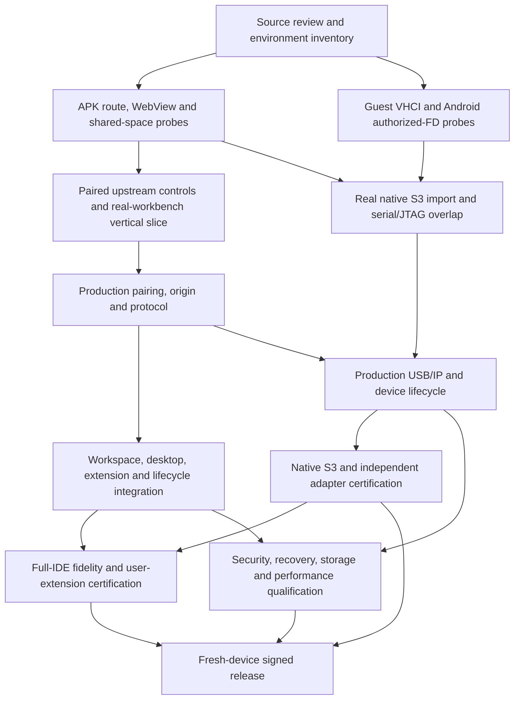

# GBCode — detailed implementation stages

**Reviewed:** 2026-10-16. **Product:** an independently branded, full desktop Code - OSS IDE for Google's Android-based Googlebook, delivered as an ordinary Android APK and executing development workloads in Google's built-in Debian Terminal VM. **Default profile:** `wsl_usbip_desktop`.

**Current state:** planning and source research only. No APK, daemon, extension, exporter, guest probe or device evidence is implemented by this handoff. No Googlebook hardware was exercised. Backend selection and every physical capability remain unapproved. Git initialization is repository setup, not an implementation milestone.

## How to use this plan

1. Read the [architecture specification](../Googlebook_CodeOSS_APK_Engineering_Plan_v2.md) for product and trust boundaries. Its former Section 14 package bodies have been moved here, not left as a competing checklist.
2. Use the stage files below as the **authoritative work-package and dependency records**. All 104 original IDs are retained. There is no required but missing `tasks.json`, `references.json`, external test-plan bundle or probe script.
3. Select the default profile: **89 scheduled packages**, including the conditional scope decisions S03.05 and S08.05. **15 alternatives are excluded.** Scheduled does not mean implemented, supported or started.
4. Schedule individual packages by their explicit dependencies, not by stage number or document order. Stages group ownership; some contain both early contracts and late certification. In particular, S05 and U01 interleave, and U03.01 starts long before U03's final review.
5. Complete a package only after its deliverable, smoke proof, acceptance evidence and independent review exist. A source audit cannot pass a device requirement. Record blocked hardware/platform work precisely and continue independent work.

## Research verdict and corrections

The architecture is a defensible **design**, not a proven Googlebook implementation. Google's [12 October Terminal announcement](https://developer.android.com/blog/posts/googlebook-linux-terminal-preview-vm) establishes a Debian VM, user-granted folders and browser localhost forwarding; it explicitly places native USB passthrough, integrated Linux GUI launch, acceleration and VM/window independence on the roadmap. This supports testing a thin Android-rendered workbench with local Debian execution, but does not prove ordinary-APK connectivity or guest VHCI support.

| Finding | Decision incorporated into the stages | Evidence |
|---|---|---|
| The original plan referred to an absent orchestration/handoff bundle. | Canonical Markdown package records, effective dependencies and real local links replace those assumptions. Future deliverable paths are labeled as future, not completed artifacts. | Repository inspection; corrected architecture §§13–17. |
| Latest stable backend candidates are not based on the same upstream release. | Compare each candidate against its own exact upstream desktop and server-backed web controls. Evaluate security freshness separately; do not force an obsolete common production baseline. Resolve embedded source independently of product/About commit. | [Upstream review §§1–3](../research/2026-10-16-upstream-review.md). |
| A browser workbench is not Electron, even with a remote Node host. | Preserve genuine workbench UI and normal user-selected extensions; explicitly classify browser, guest Node and unsupported Electron-local requirements. Full IDE includes tasks, Git, language tooling, real debugging, notebooks, webviews, profiles and offline reuse. | [Extension host documentation](https://code.visualstudio.com/api/advanced-topics/extension-host); upstream review §4. |
| MIT source is not a Marketplace, Microsoft binary, trademark or service entitlement. | Independent identity; permitted Open VSX/private registry and authorized VSIX; artifact-specific license/architecture review. Do not redistribute the Microsoft server as the baseline. | [VS Code FAQ](https://code.visualstudio.com/docs/supporting/faq); upstream review evidence E21–E24. |
| Code-server storage/origin adaptations introduce specific review work. | Audit self-hosted webview isolation and remote-secret-storage plaintext fallback; enabling remote storage is not proof of encrypted secrets or complete dirty-buffer persistence. | Upstream review E12–E13. |
| API 37 serial is documented, but its service/driver/lifecycle behavior is not target proof. | Runtime/API checks and actual device evidence; keep high-level serial providers off the default USB/IP path. | [Platform review](../research/2026-10-16-platform-review.md), P08–P15. |
| Local-network documentation does not classify the actual Terminal route; the retrieved body and a WebView search snippet disagree. | Test Chrome, native sockets and WebView independently, across applicable target SDK and permission states. No invented permission or browser-to-APK inference. | Platform review, P11 and the networking probe matrix. |
| Reusable USB/IP exporters contain concrete source gaps. | Neither candidate is production-approved unchanged. Require truthful reset/configuration/error behavior, asynchronous cancellation, descriptor fidelity and native lifetime before U01.10. | [Hardware review §§3–5](../research/2026-10-16-hardware-review.md). |
| Native ESP32-S3 USB Serial/JTAG is not supported by esptool's RFC2217/socket route. | Keep native serial, flashing and JTAG on real USB/IP. Any RFC2217 fallback uses a separately certified USB-UART profile, never fake identity. | [Espressif remote-port documentation](https://docs.espressif.com/projects/esptool/en/latest/esp32/remote-serial-ports.html); hardware review §6. |
| Separate serial/JTAG demonstrations can hide endpoint serialization. | Add short overlapping CDC/JTAG feasibility in U00.05; retain full programming/debug/concurrency certification in U02. Native Serial/JTAG versus shared-PHY USB-OTG remains distinct. | Hardware review §§6–7. |
| Original provider-specific agent assignments are unrelated to the current product requirement. | Owner roles are provider-agnostic. Optional AI integration cannot become a subscription, hosted runtime or fixed model prerequisite for the local IDE. | S08.05 scope decision; architecture §17. |

The dated reports contain exact retrieved URLs, excerpts, candidate commits and evidence limits. The architecture's other references remain inherited pointers to reopen when relevant; this review does not claim all 98 were freshly checked.

## Product completion contract

- **Original IDE:** stock Explorer, Search, SCM, Run/Debug, Extensions, editors/splits/tabs, Command Palette, Problems/Output, tasks, terminals, Settings/keybindings/themes/profiles, functioning notebooks and extension webviews. No Monaco clone, replacement dashboard, mobile editor skin or permanent hardware sidebar.
- **Local Debian execution:** shell, Git, Node workspace extension host, language servers, compilers, debug adapters, GDB and OpenOCD execute in the built-in Terminal VM. Browser UI workers stay frontend-side. No Termux, app-owned VM, streamed Linux desktop or mandatory cloud execution.
- **Desktop APK:** non-root install, physical keyboard/IME/pointer, resizing, system caption/insets, multiple windows, accessibility, clipboard/drop/file picking, scaling, external display and truthful renderer/app/VM recovery.
- **User extension choice:** original Extensions view, permitted registry and VSIX workflows, install/update/disable/uninstall and profile persistence beyond starter bundles. No claim that every proprietary, Electron-only or unsupported-ABI extension works.
- **Dedicated workspace:** independent APK and Terminal folder grants, bidirectionally verified mapping, real Git/save/watch semantics, out-of-tree tools/caches and tested backups. No silent second source tree or invented Linux path from a content URI.
- **Mandatory hardware:** actual guest VHCI importer; ordinary-APK authorized exporter; native ESP32-S3 CDC serial, verified guest flashing, source-level JTAG debugging and concurrent CDC/JTAG; one independent external adapter/target performing a meaningful program/debug operation.
- **Operational product:** paired identity, isolated native bridge, guest-wide USB consent and native revoke, bounded transport, no destructive replay, coordinated signed updates/rollback, offline provisioned workflows, reproducible build inputs, license/provenance and fresh-install evidence.

Browser/Electron and proprietary-service boundaries are explicit compatibility limits, not permission to omit the listed core workflows. Missing mandatory functionality blocks the release.

## Stage catalog

Every stage file supplies its entry/ownership contract, package dependencies, ordered implementation checkboxes, deliverables, acceptance criteria, source refresh, end-to-end smoke scenario and failure containment. The counts describe scope, not completion.

| Stage | Detailed document | Default / excluded packages | Exit evidence |
|---|---|---:|---|
| S00 | [Platform truth and feasibility](S00-platform-feasibility.md) | 6 / 0 | Actual host/guest identity, APK route, WebView features, folder mapping and USB authority records. |
| U00 | [USB/IP feasibility before scale](U00-usbip-feasibility.md) | 6 / 0 | Real guest importer plus authorized native S3 export, serial/JTAG overlap and an independent go/no-go. |
| S01 | [Real-workbench vertical slice](S01-workbench-vertical-slice.md) | 6 / 0 | Matched controls, two candidate evaluations, real APK edit/build/debug/webview/notebook path and selected backend. |
| S02 | [Connection, protocol and native trust](S02-connection-and-trust.md) | 6 / 0 | Pairing/revocation, secure origin, constrained bridge, exposure checks and exercised protocol contract. |
| U01 | [Production USB/IP](U01-production-usbip.md) | 10 / 0 | Truthful exporter, bounded authenticated relay, narrow helper, composite ownership and production-path review. |
| S03 | [Dedicated development space](S03-dedicated-workspace.md) | 6 / 0 | Verified authoritative workspace, guest-native tool placement, conditional mode decision and restore proof. |
| S04 | [Desktop workbench experience](S04-desktop-experience.md) | 6 / 0 | Real input/window/accessibility behavior, file/drop/OAuth integration and renderer-state recovery. |
| S05 | [Hardware authority and lifecycle](S05-hardware-authority.md) | 2 / 4 | Common lease/generation registry and production USB/IP foreground lifecycle; no legacy serial dependency. |
| S06 | [Optional serial fallback](S06-optional-serial-fallback.md) | 0 / 6 | Only for an approved diagnostic/reduced profile; never native USB/JTAG fulfillment. |
| S07 | [Hardware support matrix and alternatives](S07-hardware-matrix-and-alternatives.md) | 1 / 5 | S07.06 publishes real U02 evidence; other adapter/future-passthrough packages are excluded. |
| S08 | [Extension ecosystem](S08-extension-ecosystem.md) | 6 / 0 | Lawful user-selected extensions, C/C++/Python/TypeScript/notebooks, host placement, previews and offline/update proof. |
| U02 | [Hardware certification](U02-hardware-certification.md) | 8 / 0 | Native serial/flash/JTAG/concurrency, separate external adapter and physical resilience matrix. |
| U03 | [Workbench fidelity and extension freedom](U03-workbench-fidelity.md) | 8 / 0 | Original source/UI/commands, normal extension choice, WSL-style interactions and independent parity review. |
| S09 | [Lifecycle and recovery](S09-lifecycle-and-recovery.md) | 6 / 0 | Inspected bootstrap/uninstall, Terminal-dependent startup, update/rollback, VM-reset recovery and diagnostics. |
| S10 | [Security and performance](S10-security-and-performance.md) | 6 / 0 | Adversarial and fuzz results, storage/input stress, measured budgets and physical release certification. |
| S11 | [Distribution and release](S11-release.md) | 6 / 0 | Provenance/licenses, signed artifacts, channel policy, clean-device replay and all required release gates. |

## Dependency-driven execution

The following is a high-level integration graph, not a substitute for the individual package dependencies. Preparation/control work can proceed while another lane lacks hardware; its final acceptance still cannot pass from simulation.

### First executable work

1. **S00.01:** refresh relevant sources using the dated reports, establish a claim ledger and approve public-API/built-in-VM boundaries. The current research is input, not automatic completion of the package's decisions.
2. **After S00.01, run S00.02 and U00.02 independently:** inventory the physical Googlebook and build hosts while auditing/pinning exporter candidates. Hardware absence must be recorded, not guessed from this development workstation.
3. **After S00.02, open the independent lanes:** S00.03 networking, S00.05 storage, S00.06 Android USB authority, U00.01 guest-kernel inventory, and S01.01 source/license/version selection. U01.01 conformance design can begin from the exporter audit without committing to a production implementation.
4. **Join only real prerequisites:** network → S00.04 WebView; native authority → U00.03; importer inventory plus fixture review → U00.04. S01.02/.03 evaluate complete authenticated candidates, S01.04 supplies the functional fixture, and U03.01 establishes per-candidate controls before S01.05.
5. **First two product decisions:** S01.06 selects a maintainable backend with actual APK evidence; U00.06 approves or blocks USB/IP from the actual importing guest and native S3 experiment. Neither substitutes for the other. Continue independent editor work if hardware is blocked; do not advertise the default release as complete.

Do not build a polished launcher first, clone upstream into the project root, implement RFC2217 as a prerequisite to JTAG, or write a new generic USB stack before these experiments.

### Resolved default-profile overrides

The original base graph mixed serial fallbacks into default hardware work. The effective package records now use:

- **S05.06:** S05.01 + U01.02; no S05.02/S05.03 alternative group.
- **S07.06:** U02.08, not raw-tool or serial certification.
- **S09.06:** S09.02 + U01.06, not legacy serial streaming.
- **S10.02:** S02.06 + U01.10; fuzz only shipping parsers/providers.
- **S10.03:** S04.03 + U01.10 + S08.02.
- **S10.06:** U02.08 + S07.06 + S09.05.
- **S11.06:** S11.05 + S10.03/.04/.05 + U03.08 + U02.08, plus the S03.05/S08.05 scope decisions.

Additional review corrections are intentional:

- **S01.05 adds U03.01:** controls precede customized APK acceptance.
- **U01.06 adds U00.06:** production tunnel work does not bypass the physical USB/IP go/no-go. U01.01 source-level conformance work remains possible early.
- **U03.06 adds U02.02 and U02.05:** a serial/debug extension demonstration requires real imported-device workflows, not stubs. This does not gate initial extension installation on hardware.
- **U02.07 uses U02.01 + U01.10:** the separate external adapter can be certified independently of S3-specific JTAG success.
- **S11.06 adds S03.05 and S08.05:** final release closes both conditional scope decisions, so all 89 scheduled packages are in its dependency closure. A reviewed no-implementation decision is allowed only for these conditional branches and does not claim the unimplemented capability.

### Optional and conditional work

**Excluded from the default:** S05.02–S05.05, all S06 packages, and S07.01–S07.05. Their detailed plans are retained for diagnostic or explicitly approved reduced profiles, not scheduled by the default graph. No mandatory default dependency points to an excluded package.

**S03.05:** if required shared-source semantics pass, record a reviewed decision not to implement managed-native mode. If enabled, implement conflict-preserving explicit import/export and test it; do not silently replace the dedicated shared space.

**S08.05:** decide whether to ship an optional AI starter profile. A reviewed exclusion leaves ordinary user extension choice intact and requires no paid-provider setup. If included, its credentials, permission boundaries and actual provider availability must pass.

For a no-implementation decision, record implementation steps as not applicable with the approved reason; do not check them as implemented. A conditional decision cannot waive USB/IP, JTAG, an external adapter, notebook functionality, workspace correctness or original-workbench fidelity. Activating an excluded fallback requires an explicit scope decision and reviewed dependency closure; this plan does not supply a hidden automatic fallback scheduler.

## Shared contracts before parallel implementation

- **Lead/integration owner:** owns source locks, architecture decisions, cross-component versions and the final capability statement. Workers own bounded files/modules; independent reviewers own acceptance evidence.
- **Backend:** one selected production bundle with matched workbench/server assets; `WorkbenchBackendProvider` handles startup, endpoint, credentials, health, version and storage locations only. Do not invent a second editor protocol or maintain two backends indefinitely without a reason.
- **Identity/origin:** paired guest identity, native app identity, UI session and device authority are distinct. An approved origin and main frame do not make every extension/preview trusted. A loopback port is not authentication.
- **Hardware:** one whole-device lease per physical incarnation; guest interface concurrency; bounded transfer queues; actual completion lengths; cancel/drain before freeing memory; no replay after uncertain reset/programming. The guest helper exposes only validated inspect/attach/detach/status for owned imports.
- **Workspace:** guest file service is the normal editing authority; SAF handles grants/import/export. Stable space ID and nonce proof establish mapping, not cryptographic server identity.
- **State/update:** categorize sources, unsent buffers, guest configuration, browser state, extensions, secrets and native credentials separately. Update a compatibility set atomically and document rollback limits. Never equate disk persistence with encryption.
- **Source acquisition:** keep this repository as the APK/integration project. Create version locks and reviewed patches during S01; use an external source cache or ignored `upstream/checkouts/`. Preserve exact upstream commits, submodules, lockfiles/toolchains, artifact hashes and license notices. No upstream clone or remote has been added by this planning work.

Create only modules/contracts that the selected implementation needs. The architecture's proposed full directory tree is not an instruction to generate empty files or fallback implementations.

## Evidence and completion rules

Each completed package must record:

1. Package ID, accountable owner, reviewer and selected profile.
2. Exact repository/backend/upstream/exporter/tool/extension revisions and artifact hashes.
3. Source access dates and what changed from the dated review.
4. Actual commands/actions, expected versus observed results, exit/error states and evidence location.
5. Physical model/build, target SDK, WebView, guest kernel/ABI, board/adapter/firmware/cable topology when applicable. Identify synthetic/emulated/control runs separately.
6. Security and permission effects, operation-appropriate human authorization, failure containment and rollback.
7. Unsupported cases, not-run cases and remaining blockers. No fabricated screenshots, signatures, benchmarks or pass states.

Suggested states: `planned`, `researching`, `ready`, `in_progress`, `review`, `done`, `blocked-awaiting-hardware`, `blocked-platform`, and `excluded`. Conditional no-implementation decisions carry explicit reviewed reasons. A failed mandatory gate may complete an investigation report, but its **gate outcome remains fail/unknown** and cannot satisfy a downstream production/release dependency.

Store reviewed/redacted evidence with the implementation; keep raw private device logs in the ignored `docs/evidence/private/` or outside Git. Do not collect source, tokens, device identifiers, serial payloads or AI prompts by default. Retain behavioral regression coverage for meaningful faults; mocks and static plan checks never prove target support.

## Initial feasibility blockers and their clearing evidence

| Prerequisite | Current evidence boundary | Owner / clearing package |
|---|---|---|
| Actual Googlebook and built-in VM profile | Not exercised; this workstation's Linux kernel is not the target guest. | QA/GUEST — S00.02. |
| Ordinary APK and WebView route | Host-browser forwarding documented; APK behavior unknown. | ANDROID/GUEST — S00.03/.04. |
| Shared-space identity and filesystem behavior | Dual-grant workflow documented; actual mount/semantics unknown. | STORAGE — S00.05, S03.02/.03. |
| VHCI/class drivers/attach authority | Linux requirements known; actual booted Googlebook support unknown. | GUEST — U00.01/.04. |
| Correct authorized native exporter | FD pattern and concrete source gaps known; build/target behavior unproved. | ANDROID/PROTOCOL — U00.02/.03/.05, U01.10. |
| Current backend with safe webviews/state | Candidate revisions and patch risks reviewed; no APK compatibility winner. | WEB/SECURITY — S01.06, S02.03, S08.06. |
| Native S3 and separate external target | Requirements and controller distinctions documented; no physical result. | HARDWARE — U02.01–U02.08. |
| Distribution/signing policy | Primary policies reviewed, but channel, release inputs and certified ABIs not yet fixed. | RELEASE — S11.01–S11.04. |

A missing physical prerequisite is not a reason to claim mock completion or change the default profile. Escalate a measured platform limitation with the exact OS/kernel/API/error evidence; do not assume guest `sudo` can replace Google's VM kernel.

## Release gates

The default may ship only when **U00.06, U01.10, U02.08, U03.08, S10.06 and S11.06 all have passing evidence**, with their dependencies closed. At a minimum the final reviewer must reproduce installation, pairing, shared editing, guest build/debug, user extension installation, notebook/webview use, native S3 serial/flashing/JTAG/concurrency, independent external programming/debugging, interruption/recovery and provisioned offline operation.

Release certification is per actual host/OS/WebView/guest/backend/hardware combination. User-selected extensions remain possible outside the tested matrix, with honest compatibility failures. Any OS/WebView/kernel/backend/exporter/tool/extension update reopens the relevant evidence; a compatible protocol version alone does not guarantee driver, origin, reset or input behavior.

No delivery date or effort estimate is asserted before the feasibility gates and actual hardware/build-host inventory. The next implementation deliverable is the **probe APK plus guest/network/storage/kernel evidence**, not a branded editor mockup.

## Planning handoff verification

The handoff check rendered all 22 Markdown documents with a CommonMark/table parser, resolved 364 local links and heading targets, and checked reference definitions. It recovered all 104 unique package IDs, resolved an acyclic default graph, found no dependency on an excluded alternative, and confirmed all 89 scheduled packages plus all six required gates are reachable from S11.06.

`git status --short --branch` reported an empty-history `main` with the planning files untracked. `git check-ignore` confirmed exclusion of representative local credentials, Android output/configuration, guest build output, upstream checkouts and private device evidence. No remote, initial commit, implementation build or physical-device result is implied. Markdown rendering is a document check, not visual or runtime verification of an IDE.
