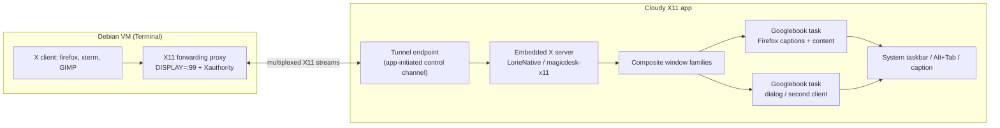

# Evaluation: MobaXterm-style X11 forwarding on Googlebook

**Date:** 2026-10-17. **Status:** decision input, superseding the assumption that
the xpra/HTML5 viewer path can be extended into freeform per-window X11. The
implemented per-app WM route is retained only as an interim demo. This document
is Googlebook-specific; generic AOSP/desktop results are controls, not target
evidence.

## Verdict

The existing Cloudy X11 stack — X clients in the Debian VM, xpra sessions, an
HTML5 canvas in a WebView — is a remote display protocol, not an X11 forwarder
into Googlebook's desktop. It can show one app per window, and the WM route can
couple one OS window to that app, but it cannot map arbitrary X top-levels to
native Googlebook windows with two-way native resize.

MobaXterm behaves differently in kind: it embeds a rootless Xorg server on the
host and forwards X11 from the remote machine; its default "multiwindow
(transparent)" mode gives **every X top-level its own native host window**, with
native move and resize; it also offers a windowed mode with Fvwm/DWM. [M1]

The Googlebook equivalent is an **embedded X server in the Android app** plus an
**X11 forwarding proxy in the Debian VM**, with each X window family presented
as a free-form Googlebook task. This is not hypothetical:
[`magicdesk-x11`](https://github.com/mekhontsev/magicdesk-x11) is an embeddable
Termux:X11 fork (GPLv3) with independent X servers, multiple native output
surfaces, individual window families, host-owned surfaces, input and icons, and
`lorieServerAcceptClient(fd)` for an already-connected X11 stream. MagicDesk uses
it to present Linux applications in ordinary Android windows. [M2] [M3]

**Recommendation (accepted in ADR-001):** pivot the Linux GUI surface to that
embedded-X-server model. The Code - OSS workbench remains the Android-rendered
main UI; this is an optional companion surface, not a Linux desktop frontend
(see “Scope vs the existing plan”).

## What the user observed

Google's own support page documents the behaviour:

> Graphical User Interface (GUI) based applications will launch in an
> alternative graphics screen in the Terminal app. To access these apps, select
> the computer icon at the top right of the Terminal app window. [G3]

So the Linux app appeared in the **Terminal app's alternative graphics screen**,
not in a Googlebook window. That screen is Terminal-owned and confined to the
Terminal app. The Linux Terminal preview blog lists “Linux GUI app support with
integration directly into the app launcher” as future work. [G1] The earlier
platform review already recorded the distinction: the alternative graphics
screen exists; launcher-integrated Linux GUI is roadmap. [P02]

Our setup's `DISPLAY=:100` and `firefox` alias only affect shells that loaded the
updated `.bashrc`; they cannot intercept arbitrary X clients. The Terminal app
may set its own `DISPLAY` for its graphics screen after `.bashrc`, or the app may
have been launched from the Terminal's GUI surface. The per-app
`cloudy-firefox`/`cloudy-run` wrappers start xpra sessions; they are not a display
that arbitrary X clients can join.

The target removes this ambiguity: the VM shell's `DISPLAY` points at the X11
forwarding proxy, so any authenticated X client launched from any shell reaches
the app's X server. The Terminal's graphics screen remains available for Google's
own integration, but it is not the forwarding endpoint.

## Googlebook OS platform contract

Googlebook is Android built on ChromeOS desktop foundations, not generic AOSP.
The window, task, input and VM rules below constrain the design; they are
primary-source findings, not assumptions. [G1] [G2] [G4] [G5] [G6] [P01] [P04]

### Windows and tasks

- Desktop windowing gives users multiple free-form, resizable app windows, a
  fixed taskbar and a system caption/header bar with minimize/maximize/close.
  Apps can run multiple **instances** in separate windows; Googlebook documents
  multi-instance as a first-class desktop workflow. Alt+Tab switches tasks. [G2]
  [G4] [G5]
- Each X top-level window must map to one Android **task whose root Activity
  owns that window**. Set initial bounds with `ActivityOptions.setLaunchBounds`;
  keep the Activity resizable; do not lock orientation (desktop windowing lets
  users resize locked apps too); handle `Configuration`/window-size changes
  without recreating the X client; never call `finish()` in `onDestroy` merely
  because of a resize. [G6]
- The **system caption bar is authoritative**. Do not draw a second set of close
  or maximize controls. Read `WindowInsets.captionBar`/content insets and measure
  the actual content area; the X surface must fill the content area below the
  caption and insets. `setTaskDescription` supplies the task caption/icon; the X
  title and `_NET_WM_ICON` feed it. [G5]
- Multi-instance affordances and taskbar grouping must not collapse independent X
  windows into one task. Declare
  `android.window.PROPERTY_SUPPORTS_MULTI_INSTANCE_SYSTEM_UI=true` where the
  system should offer “New window”; launch each X host with a distinct task and
  a stable XID identity, and deduplicate by XID rather than by Activity. [G5]
- The service/X server is a singleton independent of any Activity. Closing a
  caption, removing a task, or evicting an Activity sends `WM_DELETE_WINDOW` (or
  force-disconnects only that X client); it must not stop the X server or other
  windows. Conversely, resizing or moving a task must not close the client. The
  system may remove a task without an Activity close-request callback, so the
  host must observe task/Activity lifecycle and reconcile the engine catalog.
- Per-window density and display: use the current Activity's `WindowMetrics` and
  window configuration (not the phone's default density), and recompute on
  display move/scale changes. External displays and display removal are part of
  the required acceptance matrix.
- Input is desktop-class: keyboard, precision touchpad, mouse, IME, hover,
  right-click, wheel/horizontal scroll, contextual cursor icons and drag/drop.
  OS-reserved shortcuts stay reserved; the app exposes documented alternatives.
  The existing S04 input/window checklist applies to X windows as well. [P04]

### Debian Terminal VM

- The Terminal app runs the Debian VM. GUI programs start in the Terminal-owned
  alternative graphics screen described above; there is no documented
  third-party API to attach that display to other apps. Launcher-integrated
  Linux GUI is roadmap, not available. [G1] [G3] [P02]
- The preview documents **automatic localhost port forwarding to the host
  browser**; the support page exposes “Auto-forward all ports”, “Add port”, shared
  folders, “Keep Awake”, display resolution, console type and VM reset. [G1] [G3]
  The platform review and S00.03 correctly treat this as host-browser forwarding,
  not a universal third-party socket API; the native socket and WebView routes
  must be proven separately on the device. [P01] [P02] [S00.03]
- The companion needs the **app→VM** direction for its control channel and for
  multiplexing X11 client streams; a guest→host listener is not documented. Do
  not assume the host-browser forwarding works in reverse. The safe design is the
  existing app-initiated, authenticated connection to a VM-side proxy, which
  multiplexes the X11 streams back over the same connection.
- VM persistence independent of the Terminal window is roadmap. The app must
  show an actionable “Terminal required/unavailable” state, survive VM stop/reset,
  and never claim to start or keep the VM alive through an undocumented API. [G1]
  [P01] [P05] [P06] [S09]
- The Terminal's Advanced “display resolution” applies to its graphics screen.
  The companion's X server has its own virtual screen; the per-window output size
  is authoritative for each X window. Apps that query the X screen see the
  companion's declared root size, not the Terminal's graphics resolution.
- The Terminal graphics screen and the companion use different display endpoints.
  A shell launched from the Terminal must export the companion's `DISPLAY` and
  `XAUTHORITY`; if the Terminal's shell integration overrides them, use an
  explicit wrapper or `env DISPLAY=...` per command. Do not send users to the
  computer-icon screen for companion apps.

### Scope vs the existing plan

The existing engineering plan deliberately keeps the Code - OSS workbench
Android-rendered and does not use a Linux GUI as the frontend (§2.2, §6); it
distinguishes the Terminal's alternative graphics screen from desktop-integrated
X11 forwarding and does not require the latter for the workbench. [PLAN] This
document adds an **optional companion Linux-GUI surface**; it does not replace
the workbench, stream a Linux desktop as the main UI, or reopen the workbench's
WebView/Electron decision. The relevant plan stages still apply:

| Plan stage | Application to the companion |
|---|---|
| S00.01/S00.03 | Googlebook/Terminal source refresh; prove the app→VM route for native sockets and WebView before the tunnel. |
| S04.01–S04.03 | Window/session manager, caption/insets, resize, multi-window, keyboard/IME/pointer/clipboard/drag-drop. |
| S09.01–S09.02 | Guest bootstrap for the forwarding proxy; Terminal-required/unavailable UX; VM stop/reset. |
| S10.01–S10.03 | X11/tunnel adversarial review; native fuzzing/sanitizers; latency/memory/resize budgets. |
| S11.01 | GPLv3 engine/notices, SBOM, corresponding source, native ABI/page-size checks. |

## Evidence

| System | X server location | Window mapping | Resize |
|---|---|---|---|
| MobaXterm multiwindow (default) | Embedded Xorg in the Windows host | One native Windows window per X top-level | Native; OS resize reaches the X client |
| MobaXterm windowed mode | Same host X server + Fvwm/DWM | One host window containing a WM desktop | WM resize |
| Current shipped GBCode per-app route | VM (`xpra start`, seamless) | One Googlebook task per **app session**; dialogs stay inside that X screen | `--resize-display` + `_fit_window` (xdotool move/size); not per X window |
| WM route (design only) | VM (`xpra start-desktop` + openbox) | Planned per-app task; **not implemented** | Planned openbox maximize + display resize; not implemented |
| MagicDesk / `magicdesk-x11` | Android app process | One Android host per Composite window family | Host Surface size via `lorieOutputResize`; engine size constraints |
| xpra native client | VM server + native client | Native host windows per remote window | No client→server resize packet; server WM/pointer workarounds |

Primary sources:

- [M1] MobaXterm documentation: X server embedded and Xorg-based, X11
  forwarding through SSH (`localhost:10.0`), multiwindow (transparent) default
  and Fvwm/DWM windowed alternatives.
  <https://mobaxterm.mobatek.net/documentation.html>
- [M2] MagicDesk embedded X11: “embeds an X server and presents Linux
  applications in ordinary Android windows”; “Application windows” opens a
  chosen client window. <https://github.com/mekhontsev/magicdesk/blob/main/docs/x11.md>
- [M3] `magicdesk-x11`: multiple native output surfaces, individual window
  families, host-owned Android placement, GPLv3; `embedded.h` exposes
  `lorieServerAcceptClient`, `lorieOutputBind`, `lorieConnectionSurface`,
  `lorieOutputResize`, `lorieCloseWindow` and `windowSize` constraints.
  <https://github.com/mekhontsev/magicdesk-x11>
- Xpra seamless: each remote application gets its own window, movable and
  resizable; HTML5 keeps windows inside the browser page; a regular client is
  required for native windows.
  <https://github.com/Xpra-org/xpra/blob/master/docs/Usage/Seamless.md>
- Our spike (`native-window-surface.md`): xpra `window_move_resize` is
  server→client only; there is no client→server resize packet.

## Target architecture

### Transport (VM side)

- A new `cloudy-x11fw` process owns display `:99`, creates
  `/tmp/.X11-unix/X99`, and a per-user Xauthority cookie. `DISPLAY=:99` and
  `XAUTHORITY=...` are exported for interactive shells and wrappers.
- It accepts X11 client connections and multiplexes each as a byte stream to the
  app over the proven app-initiated connection (native WebSocket or framed
  stream). No X11 TCP listener is exposed. The app consumes each stream with
  `lorieServerAcceptClient(fd)`, preserving the normal X11 authorization
  handshake.
- The app→VM route is a device gate (S00.03): test the native socket and WebView
  separately through Terminal forwarding before making the tunnel load-bearing.
  If only WebView passes, a small local relay may bridge to the native service,
  but it must be measured, not assumed.

### Engine and Android host (app side)

- Start `lorieServerStart` in a dedicated native service/process with Xorg
  arguments (`-noreset -nolisten tcp -auth ...`) and a renderer connection.
- `window`/`windowsCommitted` callbacks create one free-form Googlebook task per
  application window family. The Activity hosts a Surface; the host binds the
  engine output (`lorieOutputBind`) and supplies `lorieConnectionSurface`.
- The Activity's content size is authoritative: `windowSize` constraints and
  `lorieOutputResize` propagate it to the X window; the client receives the
  configure event. No canvas, no display letterboxing, no WindowManager drawing
  outside the system caption.
- Input/IME/cursor/drag-drop from the window; `lorieCloseWindow` sends
  `WM_DELETE_WINDOW`; force close disconnects only the owning client. Transients/
  toolkit popups use `lorieOutputBindDependents` or a separate task based on the
  engine's role/family snapshots.
- Titles and bounded `_NET_WM_ICON` feed `setTaskDescription`; the caption
  buttons remain the OS's. Density uses `lorieSetScreenDpi` with the current
  window/display metrics.
- The host supplies the `LorieGraphics` implementation (AHardwareBuffer/Vulkan
  or a software ANativeWindow presenter). MagicDesk's GPLv3 `hosted-runtime` is
  the reference; a minimal software presenter can unblock the spike.

### What is removed or retained

- Removed from the default path: xpra display sessions, the HTML5 Windows
  canvas, the WebView token proxy, and the per-app display wrappers.
- Retained: the VM setup/connection channel, the app's launcher as an app
  catalog/session manager, and the existing Code - OSS workbench. The current
  per-app WM route stays as a demo until the native path passes acceptance.
- The Terminal app's alternative graphics screen is Google's own UI; it is not
  modified or repurposed.

## Options and effort

| Option | Meets per-window + native resize | Googlebook window model | Reuses | License | Relative effort | Verdict |
|---|---|---|---|---|---|---|
| Current per-app seamless/fit route | No: one window per app session; dialogs in-canvas; display-level resize | One task per session; window content is a canvas | Current sessiond, launcher | Project only | Shipped; interim | Interim only |
| Native xpra client | Per-window only with server-WM/pointer workarounds; no client→server resize packet | Tasks possible, but resize semantics wrong | xpra server | Project only | Medium–large | Reject for requirement |
| Embedded `magicdesk-x11` + host | Yes: one task per X family; Surface resize; native close/input | Free-form tasks, caption/taskbar/multi-instance | Engine; MagicDesk host reference | **GPLv3** | Large | Recommended (accepted) |
| X.Org/Xwayland + wlroots + our host | Yes in principle | Same tasks, more native work | MIT cores, no host | MIT/Apache | Very large | Permissive fallback only |

The engine is API 34+ (Android 14+); Googlebook meets that. The native contract
has no Java/Binder/Activity dependency; the host owns authorization, process
lifetime, clipboard/IME and Android placement — exactly the pieces we must build
or adapt.

## Staged plan

### X0 — Decision and record (this document)

- License/architecture decision: accepted, GPLv3 engine; see
  [ADR-001](../decisions/ADR-001-embedded-x11.md).
- Scope: optional companion to the Android-rendered Code - OSS workbench; keep
  the WM route as an interim demo; stop extending the HTML5 viewer.

### X1 — Engine smoke on the Googlebook

- Build `LorieNative` for arm64-v8a with NDK 27.3.13750724 (pinned at
  `upstream/engine.lock.json`); start the native smoke host and one renderer.
- Create one Android host Surface and paint one forwarded X client; prove no
  WebView/letterboxing.
- Gate: `xeyes`/`xterm` from a test socket is visible in one Googlebook task and
  the caption shows the X title.

### X2 — VM transport and Terminal routing

- Implement `cloudy-x11fw` display `:99`, Xauthority, client accept, and stream
  multiplexing over the proven app→VM route.
- Prove the route with a native socket and WebView separately (S00.03), then with
  two X clients from a Terminal shell.
- Resolve `DISPLAY` ownership: the Terminal app's graphics screen may override
  the shell environment; document the working export/wrapper and verify
  `echo $DISPLAY` against the proxy.
- Gate: two independent X clients from the VM appear as two Googlebook tasks;
  auth failure is explicit; no TCP X listener; Terminal close/reset behaviour is
  visible and recoverable.

### X3 — Googlebook per-window host

- One task per application window family; root Activity resizable, distinct
  task/XID, initial launch bounds; caption/insets/content bounds; title/icon.
- Two-way resize (`windowSize`, `lorieOutputResize`); min/aspect constraints;
  density per window; no recreate on resize; orientation unlocked.
- Pointer/keyboard/IME/cursor/scroll/drag-drop; focus/modal dialogs.
- Close/force-close; task removal vs Activity destruction; other windows survive;
  service/X server persistence.
- Gate: Firefox + xterm + a dialog; resize each from Googlebook's window handles
  and observe client reflow; taskbar/Alt+Tab entries; closing one caption leaves
  the others; external display move/scale.

### X4 — Integration

- Make the forwarding display the shell default; update setup/profile and
  wrappers; the Terminal graphics screen is not used for companion apps.
- Replace the xpra launcher/session path in the default UX; keep a debug
  fallback; the Code - OSS workbench remains the main UI.
- Lifecycle: foreground service/notification policy, background/window retention,
  VM unavailable/reconnect/reset, app update.
- Gate: fresh VM Terminal → `firefox` → one Googlebook task; no alias required;
  the workbench and X11 windows coexist without device-ownership duplication.

### X5 — Acceptance and hardening

- Googlebook acceptance matrix, performance budgets, adversarial transport/
  engine tests, clipboard/IME/dialog coverage, multi-display, packaging and
  GPLv3 provenance/corresponding source.

## Acceptance matrix

- [ ] One free-form Googlebook task per mapped X top-level; no Linux desktop,
      wallpaper, WM frame or letterboxing inside the content area.
- [ ] System caption shows the X title/icon; the taskbar and Alt+Tab list each
      window; no second set of close/maximize controls.
- [ ] Each window is independently resizable; min/aspect constraints honored;
      X client reflows in ≤ 2 s; `xdotool getwindowgeometry` matches the content
      area; DPI follows the window/display.
- [ ] Multi-instance: two windows of the same client/app and multiple apps
      coexist; XID↔task mapping is stable; no duplicate hosts; caption close
      sends `WM_DELETE_WINDOW`; force close disconnects only the owner.
- [ ] Keyboard, IME, pointer, hover, scroll, contextual cursors and drag/drop
      work; modal dialogs retain focus; OS-reserved shortcuts remain documented
      alternatives.
- [ ] The Terminal's alternative graphics screen is not the endpoint; a fresh
      Terminal shell exports the proxy `DISPLAY`/`XAUTHORITY` and `xeyes` reaches
      the companion.
- [ ] Terminal close/reopen, VM stop/reset, backend unavailable and app update
      produce an actionable state; no claim of window-independent VM lifetime.
- [ ] No X11 TCP listener; per-session cookie; authenticated app→VM tunnel;
      malformed stream/frame handling; native sanitizer/fuzz results.
- [ ] Measured input-to-pixel, resize, startup and memory/CPU on the reference
      Googlebook; external display and scale changes included.
- [ ] GPLv3 notices/SBOM/corresponding-source offer, native ABI/page-size and
      build reproducibility checks pass S11.

## Risks

- **License:** the engine and MagicDesk host are GPLv3; the combined app and its
  distribution become GPLv3. Accepted in ADR-001; S11 must implement notices and
  corresponding source. Do not vendor silently.
- **Native host size:** renderer/graphics, Surface lifecycle, input/IME,
  multi-window and dialogs are substantial; the engine's examples and MagicDesk's
  host are references, not drop-in product code.
- **Route direction:** the Terminal documents host-browser forwarding, not a
  guest→host listener. The VM proxy must multiplex over the app-initiated
  connection; do not expose raw X11 TCP. S00.03's native/WebView tests are a
  hard gate.
- **Terminal environment:** the Terminal app may set `DISPLAY` for its own
  graphics screen; the companion needs an explicit export/wrapper. The
  computer-icon screen cannot be redirected or extended.
- **VM lifetime:** window-independent VM persistence and launcher-integrated
  Linux GUI are roadmap; the app must recover when the Terminal/VM stops.
- **Googlebook window semantics:** caption insets, content bounds, multi-instance
  task grouping and task removal without close callbacks must be measured on the
  physical device, not inferred from tablet docs.
- **Performance:** local VM X11 has no WAN cost, but pixel/host-graphics
  presentation and instrumented IME/pointer paths need device measurement.
- **Shipped route:** the current code is the seamless/fit route, not the
  planned openbox/`start-desktop` WM route. Do not describe the WM route as
  implemented.
- **Coexistence:** the workbench and companion share the app/service; device
  ownership (USB leases, workspace identity) must not be duplicated across
  windows (S04). Keep the old X11 route behind a debug switch until acceptance.

## Decision (accepted 2026-10-17)

**Adopt the GPLv3 embedded X11 engine** (`magicdesk-x11`) and build the Android
host and VM forwarding proxy. Consequences: the combined app becomes GPLv3; the
current xpra WM route remains an interim demo; the permissive clean-room and
per-app streaming paths are not selected. See
[ADR-001](../decisions/ADR-001-embedded-x11.md). The X1 non-UI build gate is
passed; the on-device smoke gate is next.

## References

1. MobaXterm documentation, X11 server and X11 forwarding:
   <https://mobaxterm.mobatek.net/documentation.html> [M1]
2. Xpra seamless documentation:
   <https://github.com/Xpra-org/xpra/blob/master/docs/Usage/Seamless.md>
3. MagicDesk embedded X11:
   <https://github.com/mekhontsev/magicdesk/blob/main/docs/x11.md> [M2]
4. `magicdesk-x11` embeddable X11 engine (GPLv3):
   <https://github.com/mekhontsev/magicdesk-x11> [M3]
5. `embedded.h` host contract:
   <https://github.com/mekhontsev/magicdesk-x11/blob/main/lorie/src/main/cpp/lorie/embedded.h>
6. Googlebook developer overview:
   <https://developer.android.com/googlebook> [G2]
7. Build adaptive apps for Googlebook:
   <https://developer.android.com/develop/adaptive-apps/guides/googlebook/overview> [G4]
8. Multitasking and multi-instance:
   <https://developer.android.com/guide/topics/large-screens/multitasking-and-multi-instance> [G5]
9. Support desktop windowing (caption bar, multi-instance, header insets):
   <https://developer.android.com/develop/adaptive-apps/guides/support-desktop-windowing> [G6]
10. ChromeOS window management (launch bounds, resize, content bounds):
    <https://developer.android.com/develop/devices/chromeos/learn/window-management>
11. Use the Terminal app on Googlebook:
    <https://support.google.com/googlebook/answer/18119222?hl=en> [G3]
12. Googlebook Linux Terminal preview blog:
    <https://developer.android.com/blog/posts/googlebook-linux-terminal-preview-vm> [G1]
13. Existing engineering plan: `docs/Googlebook_CodeOSS_APK_Engineering_Plan_v2.md`;
    platform review: `docs/research/2026-10-16-platform-review.md` [PLAN] [P01] [P02]
    [P04] [P05] [P06]; stage docs S00, S04, S09, S10, S11.
14. X.Org X server (MIT) and Xwayland:
    <https://gitlab.freedesktop.org/xorg/xserver>; wlroots (MIT):
    <https://gitlab.freedesktop.org/wlroots/wlroots>
