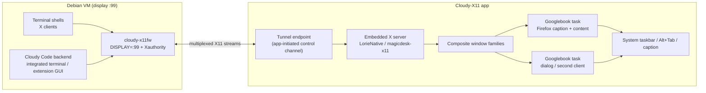

# Evaluation: MobaXterm-style X11 forwarding on Googlebook

**Date:** 2026-10-17. **Status:** decision input, superseding the assumption that
the xpra/HTML5 viewer path can be extended into freeform per-window X11.
**Detailed execution plan:** [`../cloudy-x11/NEXT-STEPS.md`](../cloudy-x11/NEXT-STEPS.md). The
shipped per-app seamless route (`xpra start` + Xvfb + `_fit_window`) is retained
only as an interim demo; the openbox/`start-desktop` WM route described in
df86bbe was never implemented. This document is Googlebook-specific; generic
AOSP/desktop results are controls, not target evidence.

> **Forward correction after reviewing `df86bbe` (commit kept, not reverted).**
> That commit was written from compacted context and is misleading in three
> ways: (1) it described the openbox/`start-desktop` WM route as the current or
> interim implementation, while the shipped code is the per-app seamless/fit
> route; (2) it treated the Terminal's built-in graphics screen as merely
> "Terminal-owned" and left routing to shell `.bashrc`/aliases, which cannot
> capture arbitrary X clients or Cloudy Code's integrated terminals; (3) it
> framed the X11 companion as optional and did not pair it with Cloudy Code's
> Linux VM backend. The correct target is a **VM-wide forwarding display**
> owned by Cloudy-X11: the Terminal's built-in X server is bypassed, not
> extended, and both Terminal shells and Cloudy Code's backend use the Cloudy
> display. The engine/ADR decision is retained; the correction is forward.

## Verdict

The existing Cloudy X11 stack — X clients in the Debian VM, xpra sessions, an
HTML5 canvas in a WebView — is a remote display protocol, not an X11 forwarder
into Googlebook's desktop. It can show one app per window, and the WM route can
couple one OS window to that app, but it cannot map arbitrary X top-levels to
native Googlebook windows with two-way native resize.

MobaXterm behaves differently in kind: it embeds a rootless Xorg server on the
host and forwards X11 from the remote machine; its default "multiwindow
(transparent)" mode gives **every X top-level its own native host window**, with
native move and resize; it also offers a windowed mode with Fvwm/DWM. [M1]

The Googlebook equivalent is an **embedded X server in the Android app** plus an
**X11 forwarding proxy in the Debian VM**, with each X window family presented
as a free-form Googlebook task. This is not hypothetical:
[`magicdesk-x11`](https://github.com/mekhontsev/magicdesk-x11) is an embeddable
Termux:X11 fork (GPLv3) with independent X servers, multiple native output
surfaces, individual window families, host-owned surfaces, input and icons, and
`lorieServerAcceptClient(fd)` for an already-connected X11 stream. MagicDesk uses
it to present Linux applications in ordinary Android windows. [M2] [M3]

**Recommendation (accepted in ADR-001):** pivot the Linux GUI surface to that
embedded-X-server model. Cloudy-X11 becomes the single X11 forwarding endpoint
for **both** the Terminal app's shells and Cloudy Code's Linux VM backend; the
workbench itself remains the Android-rendered main UI. This is not a Linux
desktop frontend and does not replace the workbench (see “Scope vs the existing
plan”).

### Product boundary: standalone Cloudy-X11

Cloudy-X11 is a separate Googlebook APK, not a screen inside the GBCode
workbench. It owns the X server/forwarding service, the VM pairing and setup,
the per-window Googlebook tasks and the control/status UI. GBCode and Cloudy
Code are VM-side consumers of the same display; neither is a dependency of
Cloudy-X11, and Cloudy-X11 must not require the GBCode token, Workbench or
Code-OSS code. The forwarding core is designed as a reusable component for a
later remote-console app (see “Standalone app and reusable core”).

### Current Cloudy-X11 implementation check (2026-10-17)

> **Extraction status:** after this check, the prototype was extracted to
> `android/cloudy-x11` (`dev.cloudy.x11`) and installed as a separate
> free-form task; the GBCode X11 activities/launcher/token/assets were removed.
> The standalone app still carries the xpra/HTML5 prototype; VM pairing and the
> engine host are the next gates. The check below records the pre-extraction
> code and why the split was required.

The repository previously contained a **prototype inside the GBCode app**, not
the standalone product:

- `dev.gbcode.app` is a single `app` Gradle module. `X11Activity` and
  `X11AppsActivity` are activities in that package, with the `X11Launcher` alias;
  there is no separate Cloudy-X11 APK/module.
- Both activities obtain the per-install token from `GbCodeApp.x11Token()`;
  the X11 UI is coupled to the GBCode application and its preferences.
- The manifest sets `resizeableActivity="true"` for `X11Activity`, but there is
  no multi-instance property and no per-window host; the launcher opens one
  viewer per session.
- The current VM payload is xpra-specific: `cloudy-x11-sessiond.py` starts
  `xpra start` seamless sessions; `cloudy-x11-proxy.py` is an HTTP/token proxy
  for the HTML5 client. Neither is an X11 protocol forwarder.
- The setup exports `DISPLAY=:100` and per-app aliases in `~/.bashrc`; there is
  no VM-wide display, no Cloudy Code backend environment, and no systemd user
  environment. This is exactly why apps launched from other VM contexts still
  land in the Terminal's graphics screen.
- The embedded `magicdesk-x11` engine is built and has started on the Googlebook
  under the app UID (X1a), but it is not integrated into the APK; there is no
  renderer/per-window Surface host, no VM display proxy, and no tunnel client.

So the prototype is useful evidence for the UI and the failure mode, but the
standalone app requires a new module/service, a new VM forwarder, a VM-wide
display contract, and the engine host. The xpra-specific proxy/sessiond and the
per-app wrappers are replaced, not extended.

## What the user observed

Google's own support page documents the behaviour:

> Graphical User Interface (GUI) based applications will launch in an
> alternative graphics screen in the Terminal app. To access these apps, select
> the computer icon at the top right of the Terminal app window. [G3]

So the Linux app appeared in the **Terminal app's alternative graphics screen**,
not in a Googlebook window. That screen is Terminal-owned and confined to the
Terminal app. The Linux Terminal preview blog lists “Linux GUI app support with
integration directly into the app launcher” as future work. [G1] The earlier
platform review already recorded the distinction: the alternative graphics
screen exists; launcher-integrated Linux GUI is roadmap. [P02]

Our setup's `DISPLAY=:100` and `firefox` alias only affect shells that loaded the
updated `.bashrc`; they cannot intercept arbitrary X clients. The Terminal app
may set its own `DISPLAY` for its graphics screen after `.bashrc`, or the app may
have been launched from the Terminal's GUI surface. The per-app
`cloudy-firefox`/`cloudy-run` wrappers start xpra sessions; they are not a display
that arbitrary X clients can join.

The target removes this ambiguity: the VM's **default** `DISPLAY` points at the
Cloudy-X11 forwarding proxy, so any authenticated X client launched from a
Terminal shell, a script, an extension host, or Cloudy Code's integrated terminal
reaches the app's X server. The Terminal's graphics screen remains available for
Google's own integration, but it is **bypassed** for Cloudy-X11 clients; it is
not the forwarding endpoint and cannot be extended by another app.

## Bypassing the Terminal app's X server (VM-wide display)

The key requirement is not to display the Terminal's screen better; it is to
make the Terminal's built-in X server irrelevant to Cloudy-X11. A per-shell
`.bashrc` export or a `firefox` alias is insufficient: it misses login shells,
scripts, extension hosts, Cloudy Code's terminals and any process started before
the setup. The design must own the VM's default display and Xauthority.

### VM-wide environment

The VM-side proxy owns display `:99` and a per-user Xauthority file. Export these
to every relevant process:

- `/etc/profile.d/cloudy-x11.sh` for login shells (bash, sh, zsh); source the
  distribution-wide profile rather than editing each user's shell rc.
- `~/.bashrc`/`~/.profile` as a user-level fallback and for interactive shells
  that do not read the profile.
- `/etc/environment` or PAM `pam_env` where the VM's GUI/session stack reads it.
- `~/.config/environment.d/90-cloudy-x11.conf` and
  `systemctl --user import-environment DISPLAY XAUTHORITY` for systemd user
  services, so extension hosts/daemons started by systemd inherit the display.
- Cloudy Code's backend: export the same variables in the Code-OSS server's
  launch environment (service unit, bootstrap script, or user service), not only
  in an interactive shell. Its integrated terminals and extension-host processes
  inherit the server environment. Restart the backend after installing the
  environment; an already-running server keeps its old `DISPLAY`.
- Applications that hardcode a display or sanitize their environment need an
  explicit wrapper; do not rely on a global export for those.

The Terminal app may itself set `DISPLAY`/`WAYLAND_DISPLAY` for its shells or its
computer-icon graphics screen. The shell profile/rc runs after the app-provided
environment, so the Cloudy value must win for interactive shells; verify with
`echo $DISPLAY`. If the Terminal app re-applies its value after the shell rc,
use a shell wrapper or an explicit `env DISPLAY=:99 XAUTHORITY=... <app>` and
report the platform behaviour; the computer-icon screen stays Google's and is
not used for Cloudy-X11 apps.

### Diagnostics and acceptance of the bypass

In **both** a fresh Terminal shell and Cloudy Code's integrated terminal:

```sh
env | grep -E '^(DISPLAY|XAUTHORITY|WAYLAND_DISPLAY)='
xauth list
xeyes
```

Expected: `DISPLAY=:99`, the Cloudy Xauthority, and `xeyes` opens as a Googlebook
task, not in the Terminal's graphics screen. If `xeyes` appears in the Terminal
screen, the environment is not Cloudy-owned; fix the profile/backend launch
before proceeding. The app must be running and its tunnel connected; otherwise
X clients fail explicitly (the app shows a connection state) rather than falling
back to the Terminal's display.

## Cloudy Code pairing

Cloudy Code is the Android workbench (WebView) with its Code - OSS/extension
host and terminals running in the same Debian VM. It does not get a separate X11
mechanism:

- The Cloudy-X11 app is the X server/forwarder; the VM's display proxy and
  Xauthority are the same ones used by the Terminal.
- The Cloudy Code backend must be launched with `DISPLAY=:99`/`XAUTHORITY` (or
  inherit them from the systemd user environment). Integrated terminals inherit
  the backend environment; commands such as `firefox`, `xterm`, debug adapters
  spawning GUI tools, and extension-launched GUI programs then reach Cloudy-X11.
- The Cloudy Code workbench remains the main IDE window; X11 apps are separate
  Googlebook tasks, exactly as in MobaXterm. Do not stream the workbench through
  the X server.
- Test the integrated terminal, a task/extension process and a script started
  before/after the backend restart; a stale backend environment is the most
  likely failure mode.

### MobaXterm analogy, applied

MobaXterm's remote X clients use a virtual display (`localhost:10.0`) forwarded
over SSH to an embedded host X server. Here the VM proxy is the virtual display,
the app-initiated authenticated tunnel is the forwarding channel, and the
embedded X server in Cloudy-X11 is the host X server. Each X top-level becomes a
free-form Googlebook task; Android window resize reaches the X client through
`lorieOutputResize`, and no whole-display canvas or Terminal screen is involved.

## Googlebook OS platform contract

Googlebook is Android built on ChromeOS desktop foundations, not generic AOSP.
The window, task, input and VM rules below constrain the design; they are
primary-source findings, not assumptions. [G1] [G2] [G4] [G5] [G6] [P01] [P04]

### Windows and tasks

- Desktop windowing gives users multiple free-form, resizable app windows, a
  fixed taskbar and a system caption/header bar with minimize/maximize/close.
  Apps can run multiple **instances** in separate windows; Googlebook documents
  multi-instance as a first-class desktop workflow. Alt+Tab switches tasks. [G2]
  [G4] [G5]
- Each X top-level window must map to one Android **task whose root Activity
  owns that window**. Set initial bounds with `ActivityOptions.setLaunchBounds`;
  keep the Activity resizable; do not lock orientation (desktop windowing lets
  users resize locked apps too); handle `Configuration`/window-size changes
  without recreating the X client; never call `finish()` in `onDestroy` merely
  because of a resize. [G6]
- The **system caption bar is authoritative**. Do not draw a second set of close
  or maximize controls. Read `WindowInsets.captionBar`/content insets and measure
  the actual content area; the X surface must fill the content area below the
  caption and insets. `setTaskDescription` supplies the task caption/icon; the X
  title and `_NET_WM_ICON` feed it. [G5]
- Multi-instance affordances and taskbar grouping must not collapse independent X
  windows into one task. Declare
  `android.window.PROPERTY_SUPPORTS_MULTI_INSTANCE_SYSTEM_UI=true` where the
  system should offer “New window”; launch each X host with a distinct task and
  a stable XID identity, and deduplicate by XID rather than by Activity. [G5]
- The service/X server is a singleton independent of any Activity. Closing a
  caption, removing a task, or evicting an Activity sends `WM_DELETE_WINDOW` (or
  force-disconnects only that X client); it must not stop the X server or other
  windows. Conversely, resizing or moving a task must not close the client. The
  system may remove a task without an Activity close-request callback, so the
  host must observe task/Activity lifecycle and reconcile the engine catalog.
- Per-window density and display: use the current Activity's `WindowMetrics` and
  window configuration (not the phone's default density), and recompute on
  display move/scale changes. External displays and display removal are part of
  the required acceptance matrix.
- Input is desktop-class: keyboard, precision touchpad, mouse, IME, hover,
  right-click, wheel/horizontal scroll, contextual cursor icons and drag/drop.
  OS-reserved shortcuts stay reserved; the app exposes documented alternatives.
  The existing S04 input/window checklist applies to X windows as well. [P04]

### Debian Terminal VM

- The Terminal app runs the Debian VM. GUI programs start in the Terminal-owned
  alternative graphics screen described above; there is no documented
  third-party API to attach that display to other apps. Launcher-integrated
  Linux GUI is roadmap, not available. [G1] [G3] [P02]
- The preview documents **automatic localhost port forwarding to the host
  browser**; the support page exposes “Auto-forward all ports”, “Add port”, shared
  folders, “Keep Awake”, display resolution, console type and VM reset. [G1] [G3]
  The platform review and S00.03 correctly treat this as host-browser forwarding,
  not a universal third-party socket API; the native socket and WebView routes
  must be proven separately on the device. [P01] [P02] [S00.03]
- The companion needs the **app→VM** direction for its control channel and for
  multiplexing X11 client streams; a guest→host listener is not documented. Do
  not assume the host-browser forwarding works in reverse. The safe design is the
  existing app-initiated, authenticated connection to a VM-side proxy, which
  multiplexes the X11 streams back over the same connection.
- VM persistence independent of the Terminal window is roadmap. The app must
  show an actionable “Terminal required/unavailable” state, survive VM stop/reset,
  and never claim to start or keep the VM alive through an undocumented API. [G1]
  [P01] [P05] [P06] [S09]
- The Terminal's Advanced “display resolution” applies to its graphics screen.
  The companion's X server has its own virtual screen; the per-window output size
  is authoritative for each X window. Apps that query the X screen see the
  companion's declared root size, not the Terminal's graphics resolution.
- The Terminal graphics screen and the companion use different display endpoints.
  A shell launched from the Terminal must export the companion's `DISPLAY` and
  `XAUTHORITY`; if the Terminal's shell integration overrides them, use an
  explicit wrapper or `env DISPLAY=...` per command. Do not send users to the
  computer-icon screen for companion apps.

### Scope vs the existing plan

The existing engineering plan deliberately keeps the Code - OSS workbench
Android-rendered and does not use a Linux GUI as the frontend (§2.2, §6); it
distinguishes the Terminal's alternative graphics screen from desktop-integrated
X11 forwarding and does not require the latter for the workbench. [PLAN] Those
decisions remain. Cloudy-X11 is a **standalone app/product**, not an optional
surface inside the GBCode workbench and not the workbench frontend. The
workbench and Cloudy Code consume the same VM display; neither is a dependency
of Cloudy-X11. The plan's S04/S09/S10/S11 acceptance patterns remain useful for
Cloudy-X11's own window/input, VM lifecycle, security/performance and release
work, but app ownership and packaging belong to Cloudy-X11:

| Plan stage | Application to Cloudy-X11 |
|---|---|
| S00.01/S00.03 | Googlebook/Terminal source refresh; prove the app→VM route for native sockets and WebView before the tunnel. |
| S04.01–S04.03 | Window/session manager, caption/insets, resize, multi-window, keyboard/IME/pointer/clipboard/drag-drop. |
| S09.01–S09.02 | Guest bootstrap for the forwarding proxy; Terminal-required/unavailable UX; VM stop/reset. |
| S10.01–S10.03 | X11/tunnel adversarial review; native fuzzing/sanitizers; latency/memory/resize budgets. |
| S11.01 | GPLv3 engine/notices, SBOM, corresponding source, native ABI/page-size checks. |

## Evidence

| System | X server location | Window mapping | Resize |
|---|---|---|---|
| MobaXterm multiwindow (default) | Embedded Xorg in the Windows host | One native Windows window per X top-level | Native; OS resize reaches the X client |
| MobaXterm windowed mode | Same host X server + Fvwm/DWM | One host window containing a WM desktop | WM resize |
| Current shipped GBCode per-app route | VM (`xpra start`, seamless) | One Googlebook task per **app session**; dialogs stay inside that X screen | `--resize-display` + `_fit_window` (xdotool move/size); not per X window |
| WM route (design only) | VM (`xpra start-desktop` + openbox) | Planned per-app task; **not implemented** | Planned openbox maximize + display resize; not implemented |
| MagicDesk / `magicdesk-x11` | Android app process | One Android host per Composite window family | Host Surface size via `lorieOutputResize`; engine size constraints |
| xpra native client | VM server + native client | Native host windows per remote window | No client→server resize packet; server WM/pointer workarounds |

Primary sources:

- [M1] MobaXterm documentation: X server embedded and Xorg-based, X11
  forwarding through SSH (`localhost:10.0`), multiwindow (transparent) default
  and Fvwm/DWM windowed alternatives.
  <https://mobaxterm.mobatek.net/documentation.html>
- [M2] MagicDesk embedded X11: “embeds an X server and presents Linux
  applications in ordinary Android windows”; “Application windows” opens a
  chosen client window. <https://github.com/mekhontsev/magicdesk/blob/main/docs/x11.md>
- [M3] `magicdesk-x11`: multiple native output surfaces, individual window
  families, host-owned Android placement, GPLv3; `embedded.h` exposes
  `lorieServerAcceptClient`, `lorieOutputBind`, `lorieConnectionSurface`,
  `lorieOutputResize`, `lorieCloseWindow` and `windowSize` constraints.
  <https://github.com/mekhontsev/magicdesk-x11>
- Xpra seamless: each remote application gets its own window, movable and
  resizable; HTML5 keeps windows inside the browser page; a regular client is
  required for native windows.
  <https://github.com/Xpra-org/xpra/blob/master/docs/Usage/Seamless.md>
- Our spike (`native-window-surface.md`): xpra `window_move_resize` is
  server→client only; there is no client→server resize packet.

## Target architecture



### Transport (VM side)

- A new `cloudy-x11fw` process owns display `:99`, creates
  `/tmp/.X11-unix/X99`, and a per-user Xauthority cookie. `DISPLAY=:99` and
  `XAUTHORITY=...` are exported VM-wide (profile, environment.d, Code-OSS
  backend launch), not only in interactive shells or aliases; this is what
  bypasses the Terminal's built-in X server.
- It accepts X11 client connections and multiplexes each as a byte stream to the
  app over the proven app-initiated connection. No X11 TCP listener is exposed.
  The VM rejects new TCP binds in the xpra/forwarding `145xx` range in this
  environment, so the VM tunnel is a **Unix socket**; the Android app cannot see
  it directly. The existing 14500 token proxy (the Terminal-forwarded port) must
  bridge an authenticated WebSocket to that Unix socket; the app then consumes
  each stream with `lorieServerAcceptClient(fd)`, preserving the normal X11
  authorization handshake.
- The app→VM route is a device gate (S00.03): test the native socket and WebView
  separately through Terminal forwarding before making the tunnel load-bearing.
  If only WebView passes, a small local relay may bridge to the native service,
  but it must be measured, not assumed.

### Engine and Android host (app side)

- Start `lorieServerStart` in a dedicated native service/process with Xorg
  arguments (`-noreset -nolisten tcp -auth ...`) and a renderer connection.
- `window`/`windowsCommitted` callbacks create one free-form Googlebook task per
  application window family. The Activity hosts a Surface; the host binds the
  engine output (`lorieOutputBind`) and supplies `lorieConnectionSurface`.
- The Activity's content size is authoritative: `windowSize` constraints and
  `lorieOutputResize` propagate it to the X window; the client receives the
  configure event. No canvas, no display letterboxing, no WindowManager drawing
  outside the system caption.
- Input/IME/cursor/drag-drop from the window; `lorieCloseWindow` sends
  `WM_DELETE_WINDOW`; force close disconnects only the owning client. Transients/
  toolkit popups use `lorieOutputBindDependents` or a separate task based on the
  engine's role/family snapshots.
- Titles and bounded `_NET_WM_ICON` feed `setTaskDescription`; the caption
  buttons remain the OS's. Density uses `lorieSetScreenDpi` with the current
  window/display metrics.
- The host supplies the `LorieGraphics` implementation (AHardwareBuffer/Vulkan
  or a software ANativeWindow presenter). MagicDesk's GPLv3 `hosted-runtime` is
  the reference; a minimal software presenter can unblock the spike.

### What is removed or retained

- Removed from the default path: xpra display sessions, the HTML5 Windows
  canvas, the WebView token proxy, and the per-app display wrappers.
- Retained: the VM setup/connection channel, the app's launcher as an app
  catalog/session manager, and the existing Code - OSS workbench. The current
  per-app WM route stays as a demo until the native path passes acceptance.
- The Terminal app's alternative graphics screen is Google's own UI; it is not
  modified or repurposed.

### Standalone app and reusable core

Cloudy-X11 is built as three layers so the later remote-console app can reuse it
without the GBCode/Code-OSS workbench:

1. **`cloudy-x11-core`** (Android library/service): the native X-server service
   (engine lifecycle, renderer connection), the per-window host manager, the
   tunnel/transport client, VM pairing/setup metadata and the input/clipboard/
   resize/close command surface. It has no GBCode token, Workbench or Code-OSS
   dependency.
2. **`cloudy-x11-app`** (standalone Googlebook APK): setup/connection status,
   the window-host Activities/tasks, service lifecycle, settings and diagnostics.
   It is installable and usable with only the Linux VM and a Terminal shell.
3. **`cloudy-x11-vm`** (guest package): the display proxy (`:99`, Xauthority),
   VM-wide environment installer and systemd user service; the app connects to
   it. It contains no UI and no Code-OSS/Cloudy Code dependency.

The future remote-console app consumes `cloudy-x11-core` and the same VM
forwarder contract; it supplies its own transport/session UI. The stable
contract should cover session start/stop, X-window creation/removal, Surface
binding, resize, input/IME, clipboard/drag/drop, close/force-close and
connection state. A test host (the current debug Activities can be the
prototype) verifies the contract without the GBCode app.

## Options and effort

| Option | Meets per-window + native resize | Googlebook window model | Reuses | License | Relative effort | Verdict |
|---|---|---|---|---|---|---|
| Current per-app seamless/fit route | No: one window per app session; dialogs in-canvas; display-level resize | One task per session; window content is a canvas | Current sessiond, launcher | Project only | Shipped; interim | Interim only |
| Native xpra client | Per-window only with server-WM/pointer workarounds; no client→server resize packet | Tasks possible, but resize semantics wrong | xpra server | Project only | Medium–large | Reject for requirement |
| Embedded `magicdesk-x11` + host | Yes: one task per X family; Surface resize; native close/input | Free-form tasks, caption/taskbar/multi-instance | Engine; MagicDesk host reference | **GPLv3** | Large | Recommended (accepted) |
| X.Org/Xwayland + wlroots + our host | Yes in principle | Same tasks, more native work | MIT cores, no host | MIT/Apache | Very large | Permissive fallback only |

The engine is API 34+ (Android 14+); Googlebook meets that. The native contract
has no Java/Binder/Activity dependency; the host owns authorization, process
lifetime, clipboard/IME and Android placement — exactly the pieces we must build
or adapt.

## Staged plan

### X0 — Decision and record (this document)

- License/architecture decision: accepted, GPLv3 engine; see
  [ADR-001](../decisions/ADR-001-embedded-x11.md).
- Product boundary: Cloudy-X11 is a standalone app/core, not a GBCode screen;
  GBCode/Cloudy Code are VM consumers. Keep the shipped xpra route as an
  interim demo only; stop extending the HTML5 viewer.

### X1 — Standalone boundary and engine smoke on the Googlebook

- Extract the GBCode-coupled prototype into `cloudy-x11-core`,
  `cloudy-x11-app` and `cloudy-x11-vm`; remove the `GbCodeApp` token/Workbench
  and xpra-specific dependencies from the X11 path. The standalone APK/service
  is the test host from here on.
- Build `LorieNative` for arm64-v8a with NDK 27.3.13750724 (pinned at
  `upstream/engine.lock.json`); start the native smoke host and one renderer.
- Create one Android host Surface and paint one forwarded X client; prove no
  WebView/letterboxing.
- Gate X1a (engine start): **passed on the Googlebook** under the app UID
  (`run-as dev.gbcode.app`): `native X11 ready :0`, exit 0, with XKB staged in
  app data. The adb-shell UID is denied `sock_file` creation by SELinux, so the
  host must run in the app UID. Gate X1b: renderer/per-window Surface and one
  forwarded client visible in a Googlebook task with the X title in the
  caption.

### X2 — VM-wide display, Terminal + Cloudy Code routing

- Implement `cloudy-x11fw` display `:99`, Xauthority, client accept, and stream
  multiplexing over the proven app→VM route.
- Install the VM-wide environment: profile, environment.d, and the Cloudy Code
  backend launch; verify the Terminal's shell and Cloudy Code's integrated
  terminal both report `DISPLAY=:99`/the Cloudy `XAUTHORITY`.
- Prove the route with a native socket and WebView separately (S00.03), then with
  two X clients from each of the Terminal shell and Cloudy Code's terminal.
- Resolve `DISPLAY` ownership: if the Terminal app or an already-running
  Code-OSS server keeps its old display, the shell/backend must be restarted or
  wrapped; document the measured behavior.
- Gate: `xeyes` from a fresh Terminal shell and from Cloudy Code's integrated
  terminal both appear as Googlebook tasks (not in the Terminal graphics
  screen); auth failure is explicit; no TCP X listener; Terminal close/reset is
  visible and recoverable.

### X3 — Googlebook per-window host

- One task per application window family; root Activity resizable, distinct
  task/XID, initial launch bounds; caption/insets/content bounds; title/icon.
- Two-way resize (`windowSize`, `lorieOutputResize`); min/aspect constraints;
  density per window; no recreate on resize; orientation unlocked.
- Pointer/keyboard/IME/cursor/scroll/drag-drop; focus/modal dialogs.
- Close/force-close; task removal vs Activity destruction; other windows survive;
  service/X server persistence.
- Gate: Firefox + xterm + a dialog; resize each from Googlebook's window handles
  and observe client reflow; taskbar/Alt+Tab entries; closing one caption leaves
  the others; external display move/scale.

### X4 — Standalone app integration and VM pairing

- Integrate the standalone app's setup/pairing, VM forwarder install, service
  lifecycle and diagnostics; keep the core independent of GBCode/Cloudy Code.
- Make the forwarding display the VM default for both the Terminal and the
  Cloudy Code backend; update setup/profile/systemd/backend launch; the Terminal
  graphics screen is not used for Cloudy-X11 apps.
- Lifecycle: foreground service/notification policy, background/window retention,
  VM unavailable/reconnect/reset, app update, Cloudy Code backend restart.
- Gate: a standalone APK (no GBCode installed/required) starts, pairs with the
  VM, and opens `firefox` from a fresh Terminal shell and from Cloudy Code's
  integrated terminal as two Googlebook tasks with no aliases; the core contract
  is exercised by a second host; the workbench and X11 windows coexist without
  device-ownership duplication.

### X5 — Acceptance and hardening

- Googlebook acceptance matrix, performance budgets, adversarial transport/
  engine tests, clipboard/IME/dialog coverage, multi-display, packaging and
  GPLv3 provenance/corresponding source.

## Acceptance matrix

- [ ] Cloudy-X11 installs and runs as a standalone APK without GBCode/Cloudy
      Code: no GBCode token, Workbench or Code-OSS dependency in the X11 path;
      the VM forwarder/core can be reused by the later remote-console app.
- [ ] One free-form Googlebook task per mapped X top-level; no Linux desktop,
      wallpaper, WM frame or letterboxing inside the content area.
- [ ] System caption shows the X title/icon; the taskbar and Alt+Tab list each
      window; no second set of close/maximize controls.
- [ ] Each window is independently resizable; min/aspect constraints honored;
      X client reflows in ≤ 2 s; `xdotool getwindowgeometry` matches the content
      area; DPI follows the window/display.
- [ ] Multi-instance: two windows of the same client/app and multiple apps
      coexist; XID↔task mapping is stable; no duplicate hosts; caption close
      sends `WM_DELETE_WINDOW`; force close disconnects only the owner.
- [ ] Keyboard, IME, pointer, hover, scroll, contextual cursors and drag/drop
      work; modal dialogs retain focus; OS-reserved shortcuts remain documented
      alternatives.
- [ ] The Terminal's alternative graphics screen is not the endpoint: a fresh
      Terminal shell and Cloudy Code's integrated terminal both export the proxy
      `DISPLAY`/`XAUTHORITY`; `xeyes`/`firefox` from either becomes a Googlebook
      task, not a Terminal-screen app.
- [ ] The VM-wide environment survives new shells, systemd user services,
      backend restarts and Cloudy Code terminals; a stale backend environment is
      detected and reported, not silently falling back to the Terminal display.
- [ ] The Terminal app's computer-icon graphics screen can still be used for
      Google's own integration, but Cloudy-X11 never depends on it.
- [ ] Terminal close/reopen, VM stop/reset, backend unavailable and app update
      produce an actionable state; no claim of window-independent VM lifetime.
- [ ] No X11 TCP listener; per-session cookie; authenticated app→VM tunnel;
      malformed stream/frame handling; native sanitizer/fuzz results.
- [ ] Measured input-to-pixel, resize, startup and memory/CPU on the reference
      Googlebook; external display and scale changes included.
- [ ] GPLv3 notices/SBOM/corresponding-source offer, native ABI/page-size and
      build reproducibility checks pass S11.

## Risks

- **License:** the engine and MagicDesk host are GPLv3; the combined app and its
  distribution become GPLv3. Accepted in ADR-001; S11 must implement notices and
  corresponding source. Do not vendor silently.
- **Native host size:** renderer/graphics, Surface lifecycle, input/IME,
  multi-window and dialogs are substantial; the engine's examples and MagicDesk's
  host are references, not drop-in product code.
- **Route direction:** the Terminal documents host-browser forwarding, not a
  guest→host listener. The VM proxy must multiplex over the app-initiated
  connection; do not expose raw X11 TCP. S00.03's native/WebView tests are a
  hard gate.
- **Terminal environment:** the Terminal app may set `DISPLAY` for its own
  graphics screen after the profile; the VM-wide export must win for shells, or
  a wrapper is required. The computer-icon screen cannot be redirected or
  extended. Test the real Terminal, not a generic Debian shell.
- **Cloudy Code environment:** an already-running Code-OSS server keeps its old
  environment; integrated terminals can therefore silently use the Terminal
  display. The backend must be restarted/inherit the VM-wide env; the setup must
  verify `DISPLAY` from the integrated terminal.
- **VM lifetime:** window-independent VM persistence and launcher-integrated
  Linux GUI are roadmap; the app must recover when the Terminal/VM stops.
- **Googlebook window semantics:** caption insets, content bounds, multi-instance
  task grouping and task removal without close callbacks must be measured on the
  physical device, not inferred from tablet docs.
- **Performance:** local VM X11 has no WAN cost, but pixel/host-graphics
  presentation and instrumented IME/pointer paths need device measurement.
- **Shipped route:** the current code is the seamless/fit route, not the
  planned openbox/`start-desktop` WM route. Do not describe the WM route as
  implemented.
- **Coexistence:** the workbench and companion share the app/service; device
  ownership (USB leases, workspace identity) must not be duplicated across
  windows (S04). Keep the old X11 route behind a debug switch until acceptance.

## Decision (accepted 2026-10-17)

**Adopt the GPLv3 embedded X11 engine** (`magicdesk-x11`) and build the Android
host and VM-wide forwarding proxy. Consequences: the combined app becomes GPLv3;
the shipped per-app seamless/fit route remains an interim demo; the permissive
clean-room and per-app streaming paths are not selected. See
[ADR-001](../decisions/ADR-001-embedded-x11.md). The X1a build/engine-start
gate passed on the Googlebook; X1b (renderer/host) and X2 (VM transport) are
next.

## References

1. MobaXterm documentation, X11 server and X11 forwarding:
   <https://mobaxterm.mobatek.net/documentation.html> [M1]
2. Xpra seamless documentation:
   <https://github.com/Xpra-org/xpra/blob/master/docs/Usage/Seamless.md>
3. MagicDesk embedded X11:
   <https://github.com/mekhontsev/magicdesk/blob/main/docs/x11.md> [M2]
4. `magicdesk-x11` embeddable X11 engine (GPLv3):
   <https://github.com/mekhontsev/magicdesk-x11> [M3]
5. `embedded.h` host contract:
   <https://github.com/mekhontsev/magicdesk-x11/blob/main/lorie/src/main/cpp/lorie/embedded.h>
6. Googlebook developer overview:
   <https://developer.android.com/googlebook> [G2]
7. Build adaptive apps for Googlebook:
   <https://developer.android.com/develop/adaptive-apps/guides/googlebook/overview> [G4]
8. Multitasking and multi-instance:
   <https://developer.android.com/guide/topics/large-screens/multitasking-and-multi-instance> [G5]
9. Support desktop windowing (caption bar, multi-instance, header insets):
   <https://developer.android.com/develop/adaptive-apps/guides/support-desktop-windowing> [G6]
10. ChromeOS window management (launch bounds, resize, content bounds):
    <https://developer.android.com/develop/devices/chromeos/learn/window-management>
11. Use the Terminal app on Googlebook:
    <https://support.google.com/googlebook/answer/18119222?hl=en> [G3]
12. Googlebook Linux Terminal preview blog:
    <https://developer.android.com/blog/posts/googlebook-linux-terminal-preview-vm> [G1]
13. Existing engineering plan: `docs/Googlebook_CodeOSS_APK_Engineering_Plan_v2.md`;
    platform review: `docs/research/2026-10-16-platform-review.md` [PLAN] [P01] [P02]
    [P04] [P05] [P06]; stage docs S00, S04, S09, S10, S11.
14. X.Org X server (MIT) and Xwayland:
    <https://gitlab.freedesktop.org/xorg/xserver>; wlroots (MIT):
    <https://gitlab.freedesktop.org/wlroots/wlroots>
