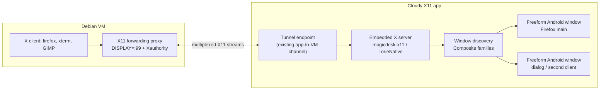

# Evaluation: MobaXterm-style X11 forwarding on Googlebook

**Date:** 2026-10-17. **Status:** decision input. This supersedes the assumption
that the xpra/HTML5 viewer path can be extended into freeform per-window X11.
It does not discard the implemented per-app WM route; that route is reclassified
as an interim demo below.

## Verdict

The current architecture — X clients in the VM, xpra sessions, an HTML5 canvas
in a WebView — is a **remote display protocol**, not an X11 forwarder into the
host desktop. It can be made to show one app per window, and the WM route
(openbox + display resize) can couple one OS window to that app, but it cannot
map arbitrary X top-levels to native Android windows with two-way native resize.
The Terminal's built-in X11 desktop is the Terminal app's own compositor and
cannot be extended by another app.

MobaXterm's behaviour is different in kind: it embeds a **rootless X server on
the host** (Xorg compiled natively for Windows), forwards X11 from the remote
server, and the default "multiwindow (transparent)" mode gives **every X
top-level its own native host window**, with native move/resize. MobaXterm also
offers a windowed mode with Fvwm/DWM, but the default is exactly the freeform
per-window model requested here.

The Android equivalent is an **embedded X server in the Googlebook app** plus an
**X11 forwarding proxy in the VM**, with each X window family presented as an
Android freeform window. This is not hypothetical: the embeddable
[`magicdesk-x11`](https://github.com/mekhontsev/magicdesk-x11) engine (a
Termux:X11 fork, GPLv3) already provides independent X servers, multiple native
output surfaces, individual window families, per-window surfaces, input,
titles/icons, clipboard, and `lorieServerAcceptClient(fd)` for an
already-connected X11 stream. MagicDesk uses it to present Linux applications
in ordinary Android windows.

**Recommendation:** pivot the X11 surface to that embedded-X-server model.
License is the decision gate: the engine and the MagicDesk host are GPLv3.
If GPLv3 is unacceptable, the permissive alternative is an X.Org MIT core (or
Xwayland + wlroots) with our own Android DDX/host — much larger work, and the
current xpra path remains only an interim.

## What the user observed

After opening Cloudy X11 and then the Linux VM Terminal, an X11 app appeared in
the Terminal's built-in desktop, not as a Cloudy X11 OS window:

- The Terminal app runs its own display/compositor for GUI integration; X11
  clients that use that `DISPLAY` render inside the Terminal app by design.
  It is not a system X server and does not expose per-window host surfaces.
- Our setup's `export DISPLAY=:100` and the `firefox` alias only affect shells
  that loaded the updated `.bashrc`. They do not intercept arbitrary X clients,
  and the Terminal app may set its own `DISPLAY` after `.bashrc` or launch GUI
  apps through its own desktop rather than the shell.
- The per-app `cloudy-firefox`/`cloudy-run` wrappers start xpra sessions; they
  are not a display that arbitrary X clients can join. Raw apps that use the
  Terminal display never reach them; raw apps that use `:100` reach the shared
  xpra base, whose per-window viewer is disabled because xpra rejects a second
  HTML5 client.

The target model removes this ambiguity: the VM shell's `DISPLAY` points at an
X11 forwarding proxy, so **any** X client launched from any shell goes to the
app's X server. The Terminal's own desktop remains available for its built-in
GUI but is not the forwarding endpoint.

## Evidence

| System | X server location | Window mapping | Resize |
|---|---|---|---|
| MobaXterm (multiwindow default) | Embedded Xorg in the Windows host | One native Windows window per X top-level | Native; OS window resize reaches the X client |
| MobaXterm (windowed mode) | Same host X server + Fvwm/DWM | One host window containing a WM desktop | Window-manager resize |
| Current GBCode xpra WM route | VM (`xpra start-desktop` + openbox) | One OS window per **app session**; dialogs stay inside that X screen | Viewer reload → display resize → openbox re-maximise; not per X window |
| Current GBCode HTML5 seamless route | VM (`xpra seamless`) | One OS window per session; windows stay inside the HTML5 page | Server→client geometry only; no client→server resize packet |
| MagicDesk / `magicdesk-x11` | Android app process | One Android host per Composite window family | Native host Surface size via `lorieOutputResize`; engine constraints |
| xpra native client | VM server + native client | Native host windows per remote window | The spike found no client→server resize packet; resize relies on server WM/pointer gestures |

Primary sources:

- MobaXterm documentation: the X server is Xorg compiled natively for Windows;
  X11 forwarding uses a local virtual display (`localhost:10.0`) through SSH;
  the default X11 mode is "multiwindow (transparent)" and there is a windowed
  mode with Fvwm/DWM. <https://mobaxterm.mobatek.net/documentation.html>
- Xpra seamless: each remote application gets its own window, movable and
  resizable; the HTML5 client keeps remote windows inside the browser page and
  a regular client is required for native windows.
  <https://github.com/Xpra-org/xpra/blob/master/docs/Usage/Seamless.md>
- MagicDesk embeds an X server and presents Linux applications in ordinary
  Android windows; "Application windows" opens a chosen client window.
  <https://github.com/mekhontsev/magicdesk/blob/main/docs/x11.md>
- `magicdesk-x11`: "multiple native output surfaces", "individual window
  families or a whole X screen", host-owned Android placement, GPLv3;
  `embedded.h` exposes `lorieServerAcceptClient`, `lorieOutputBind`,
  `lorieConnectionSurface`, `lorieOutputResize`, `lorieCloseWindow`, and
  `windowSize` constraints.
  <https://github.com/mekhontsev/magicdesk-x11>
- Our protocol spike (recorded in `native-window-surface.md`): xpra has
  `window_move_resize` only as a server→client event; there is no
  client→server resize packet. Client-side drags are pointer events handled by
  the server's WM.

## Target architecture

### Transport (VM side)

- A new `cloudy-x11fw` process owns display `:99`, creates
  `/tmp/.X11-unix/X99`, and a per-user Xauthority cookie. `DISPLAY=:99` and
  `XAUTHORITY=...` are exported for interactive shells and wrappers.
- It accepts X11 client connections and multiplexes each as a byte stream to
  the app over the existing app-initiated control connection (WebSocket or a
  framed stream). No X11 TCP listener is exposed.
- The app consumes each stream with `lorieServerAcceptClient(fd)`, which keeps
  the normal X11 authorization handshake. The engine, not the tunnel, decides
  authentication.

### Engine and Android host (app side)

- Start `lorieServerStart` in a dedicated native process with Xorg arguments
  (`-noreset -nolisten tcp -auth ...`) and a renderer connection.
- `window`/`windowsCommitted` callbacks create one Android host per application
  window family. Each host is a freeform Activity/task with a Surface; the host
  calls `lorieOutputBind(output, xid)` and `lorieConnectionSurface`.
- Android window size is authoritative: `windowSize` constraints and
  `lorieOutputResize` propagate the current host size to the X window; the X
  client receives the configure event. No canvas, no display letterboxing.
- Input: pointer/scroll/touch/key/text commands from the host; IME and focus;
  touchpad vs touchscreen separation. `lorieCloseWindow` sends
  `WM_DELETE_WINDOW`; force close disconnects only the owning client.
- Transient dialogs and toolkit popups use `lorieOutputBindDependents` or a
  separate host according to the engine's family/role snapshots. Titles and
  bounded `_NET_WM_ICON` images feed the Android task caption.
- Clipboard and drag/drop use the engine's data channels; DPI uses
  `lorieSetScreenDpi`.
- The host supplies the `LorieGraphics` implementation (AHardwareBuffer/Vulkan
  or a software ANativeWindow presenter). MagicDesk's GPLv3 `hosted-runtime`
  is the reference; a minimal software presenter can unblock the first spike.

### What is removed or retained

- Removed from the default path: xpra display sessions, the HTML5 Windows
  canvas, the token proxy needed only for the WebView, and the per-app
  `cloudy-firefox`/`cloudy-run` display wrappers.
- Retained: the VM setup/connection channel, the app's launcher as an app
  catalog and session manager, and the existing Code - OSS workbench
  integration. The current per-app WM route stays available as a demo until
  the native path passes its acceptance gate.
- The Terminal app's built-in desktop is not modified; it is the Terminal's
  own compositor. Our forwarding endpoint must own the shell's `DISPLAY`.

## Options and effort

| Option | Meets per-window + native resize | Reuses | License | Relative effort | Verdict |
|---|---|---|---|---|---|
| Current xpra WM route | No: one window per app session; dialogs in-canvas; resize is display-level | Current sessiond, launcher | Project code only | Done (demo) | Interim only; no more feature investment |
| Native xpra client | Per-window only with WM/pointer workarounds; no client→server resize packet | xpra server/sessiond | Project code only | Medium–large | Reject for the requirement |
| Embedded `magicdesk-x11` engine + our host | Yes: one Android host per X family; Surface resize; native close/input | Engine, docs/examples; MagicDesk host reference | **GPLv3** | Large (native host, graphics, transport) | Recommended if GPLv3 is acceptable |
| X.Org core / Xwayland + wlroots + our Android DDX/host | Yes in principle | MIT cores; no host | MIT/Apache-compatible | Very large (X server/compositor integration) | Permissive fallback only |

The engine is API 34+ (Android 14+); Googlebook's OS meets that. It is designed
to be embedded: no JVM, Java, Binder or Activity in the native contract. The
host owns authorization, process lifetime, clipboard grants, IME, and Android
window placement — exactly the parts we must build or adapt.

## Staged plan

### X0 — Decision and record (this document)

- Decide the license/architecture: GPLv3 engine vs permissive clean-room.
- Record the decision in an ADR; no product code depends on the engine until
  the license decision is explicit.
- Keep the current WM route as an interim demo and stop extending the HTML5
  viewer.

### X1 — Engine smoke on device

- Build `LorieNative` for arm64-v8a with the pinned NDK; run the native smoke
  host; start an X server and one renderer connection in the app.
- Provide one Android host Surface and one forwarded X client; paint its
  window; verify no WebView, no letterboxing.
- Gate: `xeyes`/`xterm` from a test socket is visible in one Android window.

### X2 — VM transport

- Implement `cloudy-x11fw` display `:99`, Xauthority, client accept, and stream
  multiplexing over the existing app control connection.
- App-side tunnel accepts streams and calls `lorieServerAcceptClient`.
- Gate: two X clients from the VM shell appear as two independent Android
  windows; auth failure is explicit; no TCP X listener.

### X3 — Per-window host

- Activity/task per application window family; Surface ownership and release;
  `windowSize`/`lorieOutputResize` two-way resize; pointer/keyboard/IME/focus;
  title/icon; close and force-close; dialogs/transients; DPI; clipboard.
- Gate: Firefox + xterm + one dialog; resize each from Android and observe the
  X client reflow; closing one leaves the other alive.

### X4 — Integration

- Make the forwarding display the shell default; update setup/profile and any
  wrappers; verify the Terminal's built-in desktop no longer captures apps
  launched from the shell (`echo $DISPLAY`, `xeyes`).
- Replace the xpra launcher/session path in the default UX; retain a diagnostic
  fallback; lifecycle (service, background, reconnect, stop).
- Gate: fresh VM Terminal → `firefox` → native OS window; no alias required.

### X5 — Acceptance and hardening

- MobaXterm parity matrix (below), performance budget, adversarial transport
  tests, clipboard/IME/dialog coverage, packaging/provenance and license
  notices.

## Acceptance matrix

- [ ] One native Android freeform window per mapped X top-level; no desktop,
      wallpaper, WM frame, or letterboxing.
- [ ] Window title and icon come from the X client; taskbar/Alt+Tab entries are
      per window.
- [ ] Resizing the Android window resizes the X client in ≤ 2 s; the client's
      minimum/aspect constraints are honored; `xdotool getwindowgeometry`
      matches the host content area.
- [ ] Multiple clients and multiple windows of one client are independent;
      closing one does not stop the others; `WM_DELETE_WINDOW` is honored and
      force close disconnects only the owning client.
- [ ] Keyboard, IME, pointer, scroll, touch and focus work; modal dialogs keep
      focus; clipboard text/HTML/image/file works both ways.
- [ ] The VM shell's `DISPLAY` reaches the app without a per-app alias; the
      Terminal app's built-in desktop is not the forwarding endpoint.
- [ ] No X11 TCP listener; per-session cookie; stream shutdown cleans up the X
      client; authentication failures are visible.
- [ ] Measured input-to-pixel and resize latency on the Googlebook; memory and
      CPU budgets recorded on the release device.

## Risks

- **License:** the engine and MagicDesk host are GPLv3. Using either makes the
  combined work GPLv3. Decide before integration; do not vendor it silently.
- **Native host size:** renderer/graphics, Surface lifecycle, input/IME,
  multiple windows and dialogs are substantial; the engine's examples and
  MagicDesk's host are references, not drop-in product code.
- **Transport direction:** the app can reach the VM, not vice versa; the VM
  proxy must multiplex over the app-initiated channel (or a verified reverse
  forward). Do not expose a raw TCP X server.
- **Terminal environment:** the Terminal app may set `DISPLAY` after shell
  startup or launch GUI apps through its own desktop. The shell profile and
  wrappers must set the forwarding display explicitly; the Terminal desktop is
  out of scope.
- **Performance:** local VM X11 has no network WAN cost; pixel transport still
  exists at the engine's host-graphics boundary. Validate on the physical
  Googlebook, not the workstation.
- **Coexistence:** the current app/launcher and Code - OSS workbench must not
  regress while the X11 surface is replaced; keep the old path behind a debug
  switch until the new acceptance matrix passes.

## Open decision

License/implementation path:

1. **Adopt the GPLv3 embedded X11 engine** and build the Android host and VM
   forwarding proxy (recommended; closest to MobaXterm).
2. **Permissive clean-room path** (MIT X.Org core / Xwayland + wlroots and our
   own DDX/host) — much larger; no GPLv3.
3. **Stay on the current per-app streaming demo** — does not satisfy freeform
   per-window forwarding; interim only.

## References

1. MobaXterm documentation, X11 server and X11-forwarding:
   <https://mobaxterm.mobatek.net/documentation.html>
2. Xpra seamless documentation:
   <https://github.com/Xpra-org/xpra/blob/master/docs/Usage/Seamless.md>
3. MagicDesk embedded X11:
   <https://github.com/mekhontsev/magicdesk/blob/main/docs/x11.md>
4. `magicdesk-x11` embeddable X11 engine (GPLv3):
   <https://github.com/mekhontsev/magicdesk-x11>
5. `embedded.h` host contract:
   <https://github.com/mekhontsev/magicdesk-x11/blob/main/lorie/src/main/cpp/lorie/embedded.h>
6. X.Org X server (MIT) and Xwayland:
   <https://gitlab.freedesktop.org/xorg/xserver>
7. wlroots (MIT):
   <https://gitlab.freedesktop.org/wlroots/wlroots>
